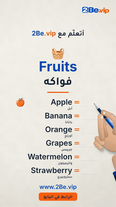
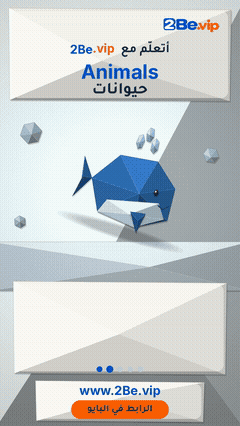
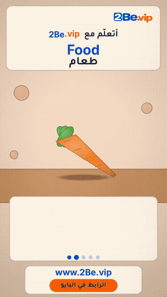
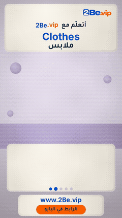
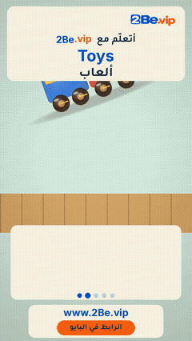
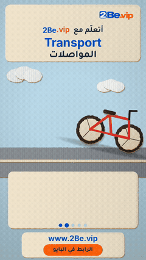
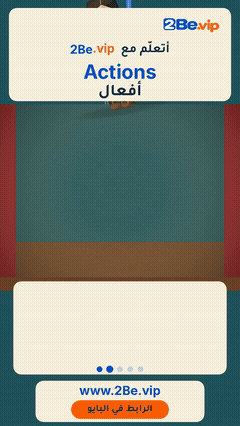
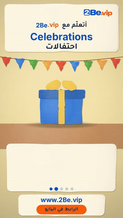

# 2Be.vip — Learn English

Free English-learning posts from the 2Be.vip community: songs, stories, handwriting reels and slideshows for Arabic speakers.

## Series

| | Series | Posts |
|---|---|---|
|  | **[2Be Felt Songs](felt-songs/)** Kids' songs in a handmade felt style that teach English words with an Egyptian Arabic song. | 13 |
|  | **[Hamada — Shadow Puppet Stories](hamada-shadow-puppet/)** Short emotional shadow-puppet stories about Hamada, told by an Egyptian narrator, each ending on hope through English. | 10 |
|  | **[Woven Stories](woven-stories/)** Ink-on-silk woven-thread animation: an idea told as threads weaving on a loom. | 1 |
|  | **[2Be with the Sami Family](sami-family/)** Felt-animation family stories (Gulf Arabic) about everyday moments where English makes the difference. | 28 |
|  | **[2Be with Youssef — Mistake Fixes](youssef-stick-figures/)** Stick-figure family scenes (Egyptian Arabic): one common English mistake, said wrong, struck out and fixed. | 7 |
|  | **[Handwriting Reels](handwriting/)** A pen writes English words and their Arabic meaning on paper — one themed word list per reel. | 250 |
|  | **[Origami Reels](origami-reels/)** Folded-paper objects unfold while the English word appears with its pronunciation in Arabic letters. | 37 |
|  | **[Clay Reels](clay-reels/)** Clay objects squash into shape while the English word appears with its pronunciation in Arabic letters. | 37 |
|  | **[Knitted Reels](knitted-reels/)** Wool objects are knitted row by row while the English word is stitched in. | 37 |
|  | **[Wooden Toy Reels](woodtoy-reels/)** Wooden toys drop and bounce on the table while the English letters bounce in. | 37 |
|  | **[Cardboard Reels](cardboard-reels/)** Cardboard cut-outs slide in while the English word is stamped on. | 43 |
|  | **[Marionette Reels](marionette-reels/)** A string puppet acts out each verb while the English word swings in on a wooden sign. | 37 |
|  | **[Low-poly 3D Reels](lowpoly-reels/)** Faceted 3D objects assemble from flying shards while the English word rises in. | 37 |
|  | **[Papier-mache Reels](papiermache-reels/)** Handmade papier-mache objects are built piece by piece while the English word is painted on. | 41 |
|  | **[Slideshows](slideshows/)** Swipeable carousel posts with everyday English tips, phrases and vocabulary. | 100 |

Each post folder holds a `thumbnail.jpg`, a ready-to-paste `caption.txt` and a README with the watch/download link. Videos are stored in this repo's **Releases** (one per series) to keep the repo small.

Made for **[2Be.vip](https://www.2be.vip)**

---

# 2Be.vip — تعلّم الإنجليزي

منشورات مجانية لتعلّم الإنجليزي من مجتمع 2Be.vip: أغانٍ وحكايات وريلز كتابة وشرائح للناطقين بالعربية.

## السلاسل

| | السلسلة | المنشورات |
|---|---|---|
|  | **[أغاني 2Be باللباد](felt-songs/)** أغاني أطفال بأسلوب اللباد المصنوع يدوياً، تعلّم كلمات إنجليزية من خلال أغنية بالعامية المصرية. | 13 |
|  | **[حكايات حمادة — مسرح خيال الظل](hamada-shadow-puppet/)** حكايات قصيرة مؤثرة بخيال الظل عن حمادة، يرويها راوٍ مصري، وتنتهي كل حكاية بأمل عن طريق الإنجليزي. | 10 |
|  | **[حكايات منسوجة](woven-stories/)** رسوم متحركة بخيوط منسوجة كالحبر على الحرير: فكرة تُروى بخيوط تُنسج على النول. | 1 |
|  | **[2Be مع عائلة سامي](sami-family/)** قصص عائلية برسوم اللباد (باللهجة الخليجية) عن لحظات يومية يصنع فيها الإنجليزي الفرق. | 28 |
|  | **[2Be مع يوسف — تصحيح الأخطاء](youssef-stick-figures/)** مشاهد عائلية برسوم بسيطة (بالعامية المصرية): غلطة إنجليزية شائعة، تُقال غلط، ثم تُشطب وتُصحَّح. | 7 |
|  | **[ريلز الكتابة بخط اليد](handwriting/)** قلم يكتب كلمات إنجليزية ومعناها بالعربي على الورق — قائمة كلمات بموضوع واحد في كل ريل. | 250 |
|  | **[ريلز الأوريغامي](origami-reels/)** كائنات من الورق المطوي تنفتح، والكلمة الإنجليزية تظهر مع نطقها بالحروف العربية. | 37 |
|  | **[ريلز الصلصال](clay-reels/)** أشياء من الصلصال تتشكّل أمامك، مع الكلمة الإنجليزية ونطقها بالحروف العربية. | 37 |
|  | **[ريلز الصوف المحبوك](knitted-reels/)** أشياء تُحاك من الصوف صفاً بعد صف، مع الكلمة الإنجليزية ونطقها بالحروف العربية. | 37 |
|  | **[ريلز الألعاب الخشبية](woodtoy-reels/)** ألعاب خشبية تقفز على الطاولة، مع الكلمة الإنجليزية ونطقها بالحروف العربية. | 37 |
|  | **[ريلز الكرتون المقصوص](cardboard-reels/)** قطع كرتون تنزلق إلى المشهد، والكلمة الإنجليزية تُختم مع نطقها بالحروف العربية. | 43 |
|  | **[ريلز الدمية المتحركة](marionette-reels/)** دمية خيوط تمثّل الفعل أمامك، مع الفعل الإنجليزي ونطقه بالحروف العربية. | 37 |
|  | **[ريلز المجسّمات ثلاثية الأبعاد](lowpoly-reels/)** مجسّمات بأوجه هندسية تتجمّع أمامك، مع الكلمة الإنجليزية ونطقها بالحروف العربية. | 37 |
|  | **[ريلز ورق الجرائد المعجون](papiermache-reels/)** أشياء مصنوعة يدوياً من ورق الجرائد تُبنى قطعة قطعة، مع الكلمة الإنجليزية ونطقها بالحروف العربية. | 41 |
|  | **[شرائح العرض](slideshows/)** منشورات شرائح تُسحب بالإصبع، فيها نصائح وعبارات ومفردات إنجليزية يومية. | 100 |

يحتوي مجلد كل منشور على صورة مصغّرة `thumbnail.jpg` وكابشن جاهز للنسخ `caption.txt` وملف README فيه رابط المشاهدة والتحميل. الفيديوهات محفوظة في قسم **Releases** في هذا المستودع (إصدار لكل سلسلة) حتى يبقى المستودع خفيفاً.

صُنع لـ **[2Be.vip](https://www.2be.vip)** — حيث تريد أن تكون

