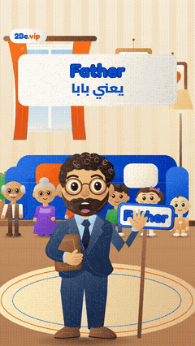
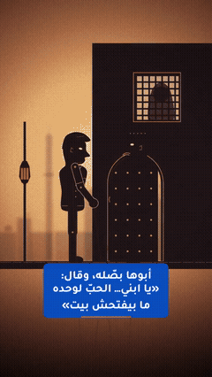
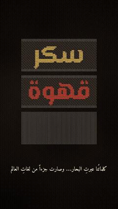
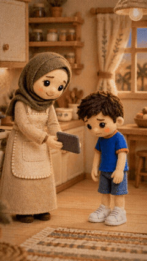
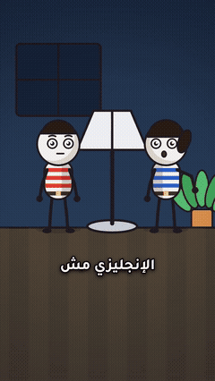

# 2Be.vip — Learn English

Free English-learning posts from the 2Be.vip community: songs, stories, handwriting reels and slideshows for Arabic speakers.

## Series

| | Series | Posts |
|---|---|---|
|  | **[2Be Felt Songs](felt-songs/)** Kids' songs in a handmade felt style that teach English words with an Egyptian Arabic song. | 11 |
|  | **[Hamada — Shadow Puppet Stories](hamada-shadow-puppet/)** Short emotional shadow-puppet stories about Hamada, told by an Egyptian narrator, each ending on hope through English. | 10 |
|  | **[Woven Stories](woven-stories/)** Ink-on-silk woven-thread animation: an idea told as threads weaving on a loom. | 1 |
|  | **[2Be with the Sami Family](sami-family/)** Felt-animation family stories (Gulf Arabic) about everyday moments where English makes the difference. | 22 |
|  | **[2Be with Youssef — Mistake Fixes](youssef-stick-figures/)** Stick-figure family scenes (Egyptian Arabic): one common English mistake, said wrong, struck out and fixed. | 4 |

Each post folder holds a `thumbnail.jpg`, a ready-to-paste `caption.txt` and a README with the watch/download link. Videos are stored in this repo's **Releases** (one per series) to keep the repo small.

Made for **[2Be.vip](https://www.2be.vip)**

---

# 2Be.vip — تعلّم الإنجليزي

منشورات مجانية لتعلّم الإنجليزي من مجتمع 2Be.vip: أغانٍ وحكايات وريلز كتابة وشرائح للناطقين بالعربية.

## السلاسل

| | السلسلة | المنشورات |
|---|---|---|
|  | **[أغاني 2Be باللباد](felt-songs/)** أغاني أطفال بأسلوب اللباد المصنوع يدوياً، تعلّم كلمات إنجليزية من خلال أغنية بالعامية المصرية. | 11 |
|  | **[حكايات حمادة — مسرح خيال الظل](hamada-shadow-puppet/)** حكايات قصيرة مؤثرة بخيال الظل عن حمادة، يرويها راوٍ مصري، وتنتهي كل حكاية بأمل عن طريق الإنجليزي. | 10 |
|  | **[حكايات منسوجة](woven-stories/)** رسوم متحركة بخيوط منسوجة كالحبر على الحرير: فكرة تُروى بخيوط تُنسج على النول. | 1 |
|  | **[2Be مع عائلة سامي](sami-family/)** قصص عائلية برسوم اللباد (باللهجة الخليجية) عن لحظات يومية يصنع فيها الإنجليزي الفرق. | 22 |
|  | **[2Be مع يوسف — تصحيح الأخطاء](youssef-stick-figures/)** مشاهد عائلية برسوم بسيطة (بالعامية المصرية): غلطة إنجليزية شائعة، تُقال غلط، ثم تُشطب وتُصحَّح. | 4 |

يحتوي مجلد كل منشور على صورة مصغّرة `thumbnail.jpg` وكابشن جاهز للنسخ `caption.txt` وملف README فيه رابط المشاهدة والتحميل. الفيديوهات محفوظة في قسم **Releases** في هذا المستودع (إصدار لكل سلسلة) حتى يبقى المستودع خفيفاً.

صُنع لـ **[2Be.vip](https://www.2be.vip)** — حيث تريد أن تكون

