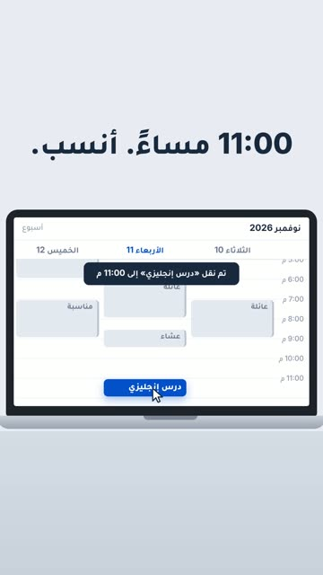

# EP04 — Drag to 11 PM

Part of **[2Be Brag Reels](../README.md)**.

[](https://github.com/waseemRIT/2be-vip-content/releases/download/media-brag-reels/EP04_Drag_to_11_PM.mp4)

▶️ **[Watch / download the video](https://github.com/waseemRIT/2be-vip-content/releases/download/media-brag-reels/EP04_Drag_to_11_PM.mp4)** (0:20, 1 MB)

## Caption

```text
درس الإنجليزي الساعة 9 الصبح؟ لا. 11 بالليل أنسب 😌 الـ60 درساً متاحة طوال مدة الوصول، تتابع وتعيد وتبدأ من جديد متى ما ناسبك — جدول يبدأ من وقتك، وليس العكس. جرّب درساً مجاناً، الرابط في البايو.
Music: "Happy Beats / Business Moves vol 11" by ende.app (CC BY 4.0). SFX: Kenney (CC0). Visuals: 2Be.vip site.
```

---

<div dir="rtl">

# الحلقة 04 — Drag to 11 PM

جزء من **[ريلز مميزات 2Be](../README.md)**.

[](https://github.com/waseemRIT/2be-vip-content/releases/download/media-brag-reels/EP04_Drag_to_11_PM.mp4)

▶️ **[شاهد / حمّل الفيديو](https://github.com/waseemRIT/2be-vip-content/releases/download/media-brag-reels/EP04_Drag_to_11_PM.mp4)** (0:20، 1 ميجابايت)

## الكابشن

```text
درس الإنجليزي الساعة 9 الصبح؟ لا. 11 بالليل أنسب 😌 الـ60 درساً متاحة طوال مدة الوصول، تتابع وتعيد وتبدأ من جديد متى ما ناسبك — جدول يبدأ من وقتك، وليس العكس. جرّب درساً مجاناً، الرابط في البايو.
Music: "Happy Beats / Business Moves vol 11" by ende.app (CC BY 4.0). SFX: Kenney (CC0). Visuals: 2Be.vip site.
```

</div>
