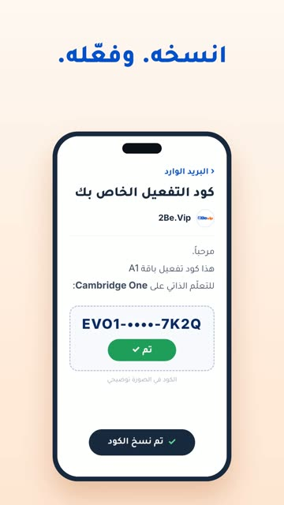

# EP08 — The Code Email

Part of **[2Be Brag Reels](../README.md)**.

[](https://github.com/waseemRIT/2be-vip-content/releases/download/media-brag-reels/EP08_The_Code_Email.mp4)

▶️ **[Watch / download the video](https://github.com/waseemRIT/2be-vip-content/releases/download/media-brag-reels/EP08_The_Code_Email.mp4)** (0:20, 2 MB)

## Caption

```text
«كود التفعيل الخاص بك» يصلك بالبريد 📩 انسخه، وفعّله على Cambridge One، فتنفتح وحداتك الـ12: ستون درساً بمنهج كامبريدج، كلها مفتوحة من اليوم الأول ولمدة 18 شهراً. جرّب درساً مجاناً، الرابط في البايو.
Music: "Happy Beats / Business Moves vol 10" by ende.app (CC BY 4.0). SFX: Kenney (CC0). Visuals: 2Be.vip site.
```

---

<div dir="rtl">

# الحلقة 08 — The Code Email

جزء من **[ريلز مميزات 2Be](../README.md)**.

[](https://github.com/waseemRIT/2be-vip-content/releases/download/media-brag-reels/EP08_The_Code_Email.mp4)

▶️ **[شاهد / حمّل الفيديو](https://github.com/waseemRIT/2be-vip-content/releases/download/media-brag-reels/EP08_The_Code_Email.mp4)** (0:20، 2 ميجابايت)

## الكابشن

```text
«كود التفعيل الخاص بك» يصلك بالبريد 📩 انسخه، وفعّله على Cambridge One، فتنفتح وحداتك الـ12: ستون درساً بمنهج كامبريدج، كلها مفتوحة من اليوم الأول ولمدة 18 شهراً. جرّب درساً مجاناً، الرابط في البايو.
Music: "Happy Beats / Business Moves vol 10" by ende.app (CC BY 4.0). SFX: Kenney (CC0). Visuals: 2Be.vip site.
```

</div>
