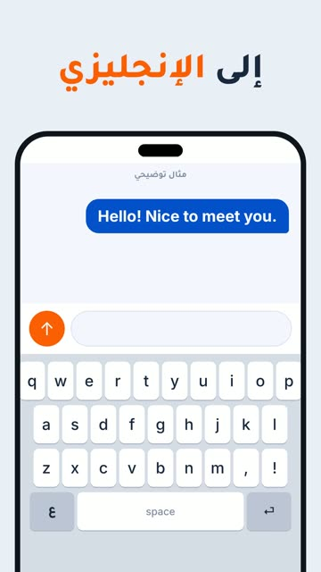

# EP14 — Keyboard Switch

Part of **[2Be Brag Reels](../README.md)**.

[](https://github.com/waseemRIT/2be-vip-content/releases/download/media-brag-reels/EP14_Keyboard_Switch.mp4)

▶️ **[Watch / download the video](https://github.com/waseemRIT/2be-vip-content/releases/download/media-brag-reels/EP14_Keyboard_Switch.mp4)** (0:20, 1 MB)

## Caption

```text
من «مرحباً، أنا» إلى «Hello! Nice to meet you.» ⌨️ ابدأ بمستوى A1: 60 درساً بمنهج كامبريدج، وتكلّم مع معلّم في 5 حصص فردية أو 20 جماعية. جرّب درساً مجاناً، الرابط في البايو.

Music: "Happy Beats / Business Moves vol 11" by ende.app (CC BY 4.0). SFX: Kenney (CC0). Visuals: 2Be.vip site.
```

---

<div dir="rtl">

# الحلقة 14 — Keyboard Switch

جزء من **[ريلز مميزات 2Be](../README.md)**.

[](https://github.com/waseemRIT/2be-vip-content/releases/download/media-brag-reels/EP14_Keyboard_Switch.mp4)

▶️ **[شاهد / حمّل الفيديو](https://github.com/waseemRIT/2be-vip-content/releases/download/media-brag-reels/EP14_Keyboard_Switch.mp4)** (0:20، 1 ميجابايت)

## الكابشن

```text
من «مرحباً، أنا» إلى «Hello! Nice to meet you.» ⌨️ ابدأ بمستوى A1: 60 درساً بمنهج كامبريدج، وتكلّم مع معلّم في 5 حصص فردية أو 20 جماعية. جرّب درساً مجاناً، الرابط في البايو.

Music: "Happy Beats / Business Moves vol 11" by ende.app (CC BY 4.0). SFX: Kenney (CC0). Visuals: 2Be.vip site.
```

</div>
