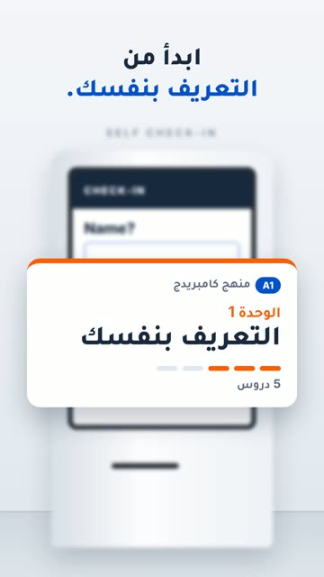

# EP17 — Hotel Kiosk

Part of **[2Be Brag Reels](../README.md)**.

[](https://github.com/waseemRIT/2be-vip-content/releases/download/media-brag-reels/EP17_Hotel_Kiosk.mp4)

▶️ **[Watch / download the video](https://github.com/waseemRIT/2be-vip-content/releases/download/media-brag-reels/EP17_Hotel_Kiosk.mp4)** (0:20, 1 MB)

## Caption

```text
Name? Nights? Passport? ثلاثة أسئلة على شاشة الفندق وتوقّفت؟ ابدأ من الوحدة 1: التعريف بنفسك، بمنهج كامبريدج، و60 درساً كلها مفتوحة من اليوم الأول. جرّب درساً مجاناً، الرابط في البايو.

Music: "Happy Beats / Business Moves vol 9" by ende.app (CC BY 4.0). SFX: Kenney (CC0). Visuals: 2Be.vip site.
```

---

<div dir="rtl">

# الحلقة 17 — Hotel Kiosk

جزء من **[ريلز مميزات 2Be](../README.md)**.

[](https://github.com/waseemRIT/2be-vip-content/releases/download/media-brag-reels/EP17_Hotel_Kiosk.mp4)

▶️ **[شاهد / حمّل الفيديو](https://github.com/waseemRIT/2be-vip-content/releases/download/media-brag-reels/EP17_Hotel_Kiosk.mp4)** (0:20، 1 ميجابايت)

## الكابشن

```text
Name? Nights? Passport? ثلاثة أسئلة على شاشة الفندق وتوقّفت؟ ابدأ من الوحدة 1: التعريف بنفسك، بمنهج كامبريدج، و60 درساً كلها مفتوحة من اليوم الأول. جرّب درساً مجاناً، الرابط في البايو.

Music: "Happy Beats / Business Moves vol 9" by ende.app (CC BY 4.0). SFX: Kenney (CC0). Visuals: 2Be.vip site.
```

</div>
