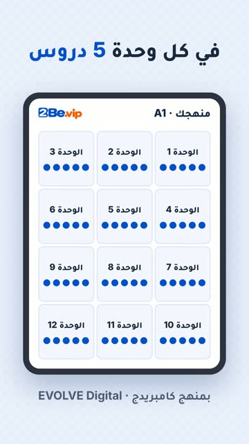

# EP33 — Puzzle Grid

Part of **[2Be Brag Reels](../README.md)**.

[](https://github.com/waseemRIT/2be-vip-content/releases/download/media-brag-reels/EP33_Puzzle_Grid.mp4)

▶️ **[Watch / download the video](https://github.com/waseemRIT/2be-vip-content/releases/download/media-brag-reels/EP33_Puzzle_Grid.mp4)** (0:19, 2 MB)

## Caption

```text
12 قطعة… تكمّل الصورة 🧩 12 وحدة، وفي كل وحدة 5 دروس = 60 درساً بمنهج كامبريدج، كلها مفتوحة من أوّل يوم ولمدة 18 شهراً. التسجيل مجاني وأول حصة تجريبية مجانية، الرابط في البايو.

Music: "Happy Beats / Business Moves vol 10" by ende.app (CC BY 4.0). SFX: Kenney (CC0). Visuals: 2Be.vip site.
```

---

<div dir="rtl">

# الحلقة 33 — Puzzle Grid

جزء من **[ريلز مميزات 2Be](../README.md)**.

[](https://github.com/waseemRIT/2be-vip-content/releases/download/media-brag-reels/EP33_Puzzle_Grid.mp4)

▶️ **[شاهد / حمّل الفيديو](https://github.com/waseemRIT/2be-vip-content/releases/download/media-brag-reels/EP33_Puzzle_Grid.mp4)** (0:19، 2 ميجابايت)

## الكابشن

```text
12 قطعة… تكمّل الصورة 🧩 12 وحدة، وفي كل وحدة 5 دروس = 60 درساً بمنهج كامبريدج، كلها مفتوحة من أوّل يوم ولمدة 18 شهراً. التسجيل مجاني وأول حصة تجريبية مجانية، الرابط في البايو.

Music: "Happy Beats / Business Moves vol 10" by ende.app (CC BY 4.0). SFX: Kenney (CC0). Visuals: 2Be.vip site.
```

</div>
