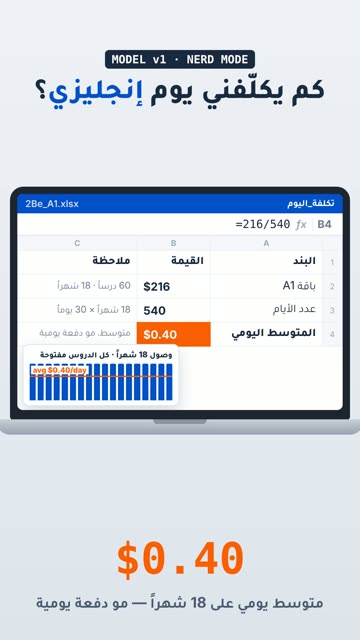

# EP34 — Spreadsheet Nerd

Part of **[2Be Brag Reels](../README.md)**.

[](https://github.com/waseemRIT/2be-vip-content/releases/download/media-brag-reels/EP34_Spreadsheet_Nerd.mp4)

▶️ **[Watch / download the video](https://github.com/waseemRIT/2be-vip-content/releases/download/media-brag-reels/EP34_Spreadsheet_Nerd.mp4)** (0:17, 1 MB)

## Caption

```text
حسبتها في جدول 🤓 ‎=216/540 → ‎$0.40. يعني بأقل من نصف دولار يومياً (متوسط تكلفة باقة A1 كاملة ‎$216 على 18 شهراً، مو دفعة يومية): 60 درساً بمنهج كامبريدج و5 حصص فردية أو 20 جماعية. التسجيل مجاني، الرابط في البايو.

Music: "Happy Beats / Business Moves vol 11" by ende.app (CC BY 4.0). SFX: Kenney (CC0). Visuals: 2Be.vip site.
```

---

<div dir="rtl">

# الحلقة 34 — Spreadsheet Nerd

جزء من **[ريلز مميزات 2Be](../README.md)**.

[](https://github.com/waseemRIT/2be-vip-content/releases/download/media-brag-reels/EP34_Spreadsheet_Nerd.mp4)

▶️ **[شاهد / حمّل الفيديو](https://github.com/waseemRIT/2be-vip-content/releases/download/media-brag-reels/EP34_Spreadsheet_Nerd.mp4)** (0:17، 1 ميجابايت)

## الكابشن

```text
حسبتها في جدول 🤓 ‎=216/540 → ‎$0.40. يعني بأقل من نصف دولار يومياً (متوسط تكلفة باقة A1 كاملة ‎$216 على 18 شهراً، مو دفعة يومية): 60 درساً بمنهج كامبريدج و5 حصص فردية أو 20 جماعية. التسجيل مجاني، الرابط في البايو.

Music: "Happy Beats / Business Moves vol 11" by ende.app (CC BY 4.0). SFX: Kenney (CC0). Visuals: 2Be.vip site.
```

</div>
