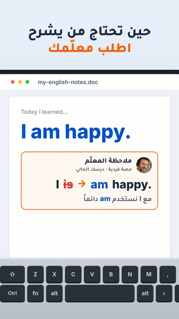

# EP48 — Undo the Mistake

Part of **[2Be Brag Reels](../README.md)**.

[](https://github.com/waseemRIT/2be-vip-content/releases/download/media-brag-reels/EP48_Undo_the_Mistake.mp4)

▶️ **[Watch / download the video](https://github.com/waseemRIT/2be-vip-content/releases/download/media-brag-reels/EP48_Undo_the_Mistake.mp4)** (0:19, 1 MB)

## Caption

```text
كتبت «I is happy»؟ تراجع… والمعلّم يشرح لك السبب: «I am happy». مع 2Be الدعم مرتبط بالدرس الذي تختاره — 5 حصص فردية أو 20 جماعية حسب توفّر المعلّم، بمنهج كامبريدج. جرّب درساً مجاناً، الرابط في البايو.

Music: "Happy Beats / Business Moves vol 10" by ende.app (CC BY 4.0). SFX: Kenney (CC0). Visuals: 2Be.vip site.
```

---

<div dir="rtl">

# الحلقة 48 — Undo the Mistake

جزء من **[ريلز مميزات 2Be](../README.md)**.

[](https://github.com/waseemRIT/2be-vip-content/releases/download/media-brag-reels/EP48_Undo_the_Mistake.mp4)

▶️ **[شاهد / حمّل الفيديو](https://github.com/waseemRIT/2be-vip-content/releases/download/media-brag-reels/EP48_Undo_the_Mistake.mp4)** (0:19، 1 ميجابايت)

## الكابشن

```text
كتبت «I is happy»؟ تراجع… والمعلّم يشرح لك السبب: «I am happy». مع 2Be الدعم مرتبط بالدرس الذي تختاره — 5 حصص فردية أو 20 جماعية حسب توفّر المعلّم، بمنهج كامبريدج. جرّب درساً مجاناً، الرابط في البايو.

Music: "Happy Beats / Business Moves vol 10" by ende.app (CC BY 4.0). SFX: Kenney (CC0). Visuals: 2Be.vip site.
```

</div>
