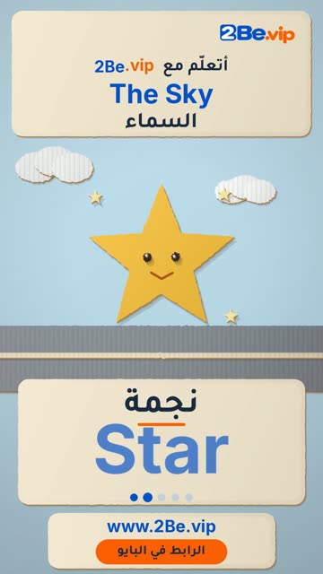

# EP05 — The Sky

Part of **[Cardboard Reels](../README.md)**.

[](https://github.com/waseemRIT/2be-vip-content/releases/download/media-cardboard-reels/EP05_The_Sky.mp4)

▶️ **[Watch / download the video](https://github.com/waseemRIT/2be-vip-content/releases/download/media-cardboard-reels/EP05_The_Sky.mp4)** (0:29, 7 MB)

## Caption

```text
The Sky | السماء — 5 English words 🎨
Moon = قمر · Star = نجمة · Bird = طائر · Kite = طائرة ورقية · Balloon = بالون

تعلّم الإنجليزي مع 2Be.vip — الرابط في البايو 🔗
Learn English with 2Be.vip — link in bio

Music: "Glitter Blast" Kevin MacLeod (incompetech.com) — CC BY 4.0

#2Be #2BeVIP #تعلم_الانجليزي #LearnEnglish #English
```

---

<div dir="rtl">

# الحلقة 05 — The Sky

جزء من **[ريلز الكرتون المقصوص](../README.md)**.

[](https://github.com/waseemRIT/2be-vip-content/releases/download/media-cardboard-reels/EP05_The_Sky.mp4)

▶️ **[شاهد / حمّل الفيديو](https://github.com/waseemRIT/2be-vip-content/releases/download/media-cardboard-reels/EP05_The_Sky.mp4)** (0:29، 7 ميجابايت)

## الكابشن

```text
The Sky | السماء — 5 English words 🎨
Moon = قمر · Star = نجمة · Bird = طائر · Kite = طائرة ورقية · Balloon = بالون

تعلّم الإنجليزي مع 2Be.vip — الرابط في البايو 🔗
Learn English with 2Be.vip — link in bio

Music: "Glitter Blast" Kevin MacLeod (incompetech.com) — CC BY 4.0

#2Be #2BeVIP #تعلم_الانجليزي #LearnEnglish #English
```

</div>
