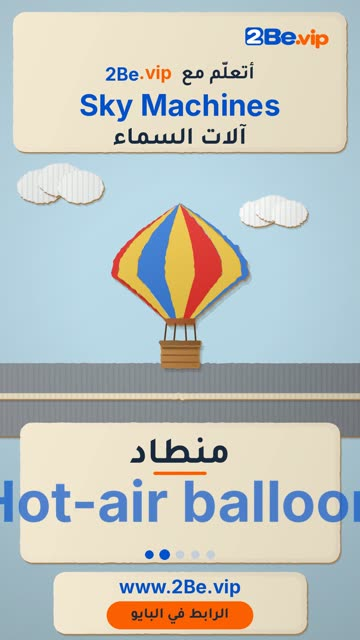

# EP22 — Sky Machines

Part of **[Cardboard Reels](../README.md)**.

[](https://github.com/waseemRIT/2be-vip-content/releases/download/media-cardboard-reels/EP22_Sky_Machines.mp4)

▶️ **[Watch / download the video](https://github.com/waseemRIT/2be-vip-content/releases/download/media-cardboard-reels/EP22_Sky_Machines.mp4)** (0:29, 7 MB)

## Caption

```text
Sky Machines | آلات السماء — 5 English words 🎨
Rocket = صاروخ · Hot-air balloon = منطاد · Glider = طائرة شراعية · Parachute = مظلة هبوط · Jet = طائرة نفاثة

تعلّم الإنجليزي مع 2Be.vip — الرابط في البايو 🔗
Learn English with 2Be.vip — link in bio

Music: "Brightly Fancy" Kevin MacLeod (incompetech.com) — CC BY 4.0

#2Be #2BeVIP #تعلم_الانجليزي #LearnEnglish #English
```

---

<div dir="rtl">

# الحلقة 22 — Sky Machines

جزء من **[ريلز الكرتون المقصوص](../README.md)**.

[](https://github.com/waseemRIT/2be-vip-content/releases/download/media-cardboard-reels/EP22_Sky_Machines.mp4)

▶️ **[شاهد / حمّل الفيديو](https://github.com/waseemRIT/2be-vip-content/releases/download/media-cardboard-reels/EP22_Sky_Machines.mp4)** (0:29، 7 ميجابايت)

## الكابشن

```text
Sky Machines | آلات السماء — 5 English words 🎨
Rocket = صاروخ · Hot-air balloon = منطاد · Glider = طائرة شراعية · Parachute = مظلة هبوط · Jet = طائرة نفاثة

تعلّم الإنجليزي مع 2Be.vip — الرابط في البايو 🔗
Learn English with 2Be.vip — link in bio

Music: "Brightly Fancy" Kevin MacLeod (incompetech.com) — CC BY 4.0

#2Be #2BeVIP #تعلم_الانجليزي #LearnEnglish #English
```

</div>
