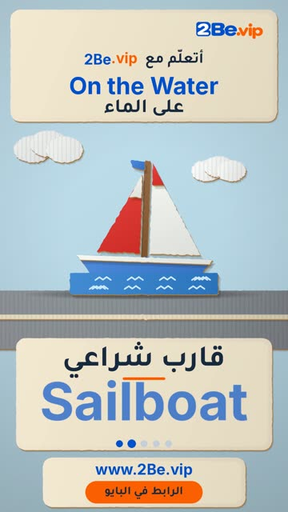

# EP23 — On the Water

Part of **[Cardboard Reels](../README.md)**.

[](https://github.com/waseemRIT/2be-vip-content/releases/download/media-cardboard-reels/EP23_On_the_Water.mp4)

▶️ **[Watch / download the video](https://github.com/waseemRIT/2be-vip-content/releases/download/media-cardboard-reels/EP23_On_the_Water.mp4)** (0:29, 8 MB)

## Caption

```text
On the Water | على الماء — 5 English words 🎨
Canoe = زورق · Sailboat = قارب شراعي · Ferry = عبّارة · Submarine = غواصة · Yacht = يخت

تعلّم الإنجليزي مع 2Be.vip — الرابط في البايو 🔗
Learn English with 2Be.vip — link in bio

Music: "Beachfront Celebration" Kevin MacLeod (incompetech.com) — CC BY 4.0

#2Be #2BeVIP #تعلم_الانجليزي #LearnEnglish #English
```

---

<div dir="rtl">

# الحلقة 23 — On the Water

جزء من **[ريلز الكرتون المقصوص](../README.md)**.

[](https://github.com/waseemRIT/2be-vip-content/releases/download/media-cardboard-reels/EP23_On_the_Water.mp4)

▶️ **[شاهد / حمّل الفيديو](https://github.com/waseemRIT/2be-vip-content/releases/download/media-cardboard-reels/EP23_On_the_Water.mp4)** (0:29، 8 ميجابايت)

## الكابشن

```text
On the Water | على الماء — 5 English words 🎨
Canoe = زورق · Sailboat = قارب شراعي · Ferry = عبّارة · Submarine = غواصة · Yacht = يخت

تعلّم الإنجليزي مع 2Be.vip — الرابط في البايو 🔗
Learn English with 2Be.vip — link in bio

Music: "Beachfront Celebration" Kevin MacLeod (incompetech.com) — CC BY 4.0

#2Be #2BeVIP #تعلم_الانجليزي #LearnEnglish #English
```

</div>
