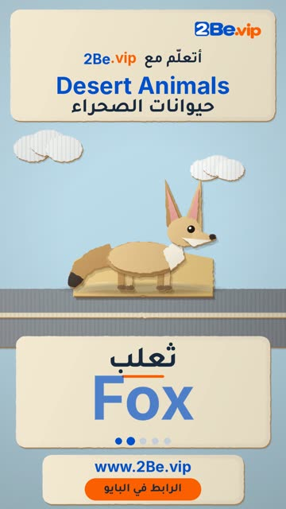

# EP36 — Desert Animals

Part of **[Cardboard Reels](../README.md)**.

[](https://github.com/waseemRIT/2be-vip-content/releases/download/media-cardboard-reels/EP36_Desert_Animals.mp4)

▶️ **[Watch / download the video](https://github.com/waseemRIT/2be-vip-content/releases/download/media-cardboard-reels/EP36_Desert_Animals.mp4)** (0:29, 7 MB)

## Caption

```text
Desert Animals | حيوانات الصحراء — 5 English words 🎨
Lizard = سحلية · Fox = ثعلب · Gazelle = غزال · Oryx = مها · Hare = أرنب بري

تعلّم الإنجليزي مع 2Be.vip — الرابط في البايو 🔗
Learn English with 2Be.vip — link in bio

Music: "Quirky Dog" Kevin MacLeod (incompetech.com) — CC BY 4.0

#2Be #2BeVIP #تعلم_الانجليزي #LearnEnglish #English
```

---

<div dir="rtl">

# الحلقة 36 — Desert Animals

جزء من **[ريلز الكرتون المقصوص](../README.md)**.

[](https://github.com/waseemRIT/2be-vip-content/releases/download/media-cardboard-reels/EP36_Desert_Animals.mp4)

▶️ **[شاهد / حمّل الفيديو](https://github.com/waseemRIT/2be-vip-content/releases/download/media-cardboard-reels/EP36_Desert_Animals.mp4)** (0:29، 7 ميجابايت)

## الكابشن

```text
Desert Animals | حيوانات الصحراء — 5 English words 🎨
Lizard = سحلية · Fox = ثعلب · Gazelle = غزال · Oryx = مها · Hare = أرنب بري

تعلّم الإنجليزي مع 2Be.vip — الرابط في البايو 🔗
Learn English with 2Be.vip — link in bio

Music: "Quirky Dog" Kevin MacLeod (incompetech.com) — CC BY 4.0

#2Be #2BeVIP #تعلم_الانجليزي #LearnEnglish #English
```

</div>
