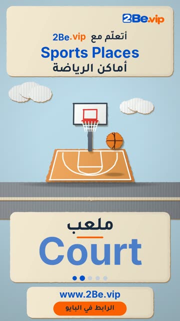

# EP49 — Sports Places

Part of **[Cardboard Reels](../README.md)**.

[](https://github.com/waseemRIT/2be-vip-content/releases/download/media-cardboard-reels/EP49_Sports_Places.mp4)

▶️ **[Watch / download the video](https://github.com/waseemRIT/2be-vip-content/releases/download/media-cardboard-reels/EP49_Sports_Places.mp4)** (0:29, 8 MB)

## Caption

```text
Sports Places | أماكن الرياضة — 5 English words 🎨
Pool = مسبح · Court = ملعب · Gym = صالة رياضة · Track = مضمار · Goal = مرمى

تعلّم الإنجليزي مع 2Be.vip — الرابط في البايو 🔗
Learn English with 2Be.vip — link in bio

Music: "Funky Chunk" Kevin MacLeod (incompetech.com) — CC BY 4.0

#2Be #2BeVIP #تعلم_الانجليزي #LearnEnglish #English
```

---

<div dir="rtl">

# الحلقة 49 — Sports Places

جزء من **[ريلز الكرتون المقصوص](../README.md)**.

[](https://github.com/waseemRIT/2be-vip-content/releases/download/media-cardboard-reels/EP49_Sports_Places.mp4)

▶️ **[شاهد / حمّل الفيديو](https://github.com/waseemRIT/2be-vip-content/releases/download/media-cardboard-reels/EP49_Sports_Places.mp4)** (0:29، 8 ميجابايت)

## الكابشن

```text
Sports Places | أماكن الرياضة — 5 English words 🎨
Pool = مسبح · Court = ملعب · Gym = صالة رياضة · Track = مضمار · Goal = مرمى

تعلّم الإنجليزي مع 2Be.vip — الرابط في البايو 🔗
Learn English with 2Be.vip — link in bio

Music: "Funky Chunk" Kevin MacLeod (incompetech.com) — CC BY 4.0

#2Be #2BeVIP #تعلم_الانجليزي #LearnEnglish #English
```

</div>
