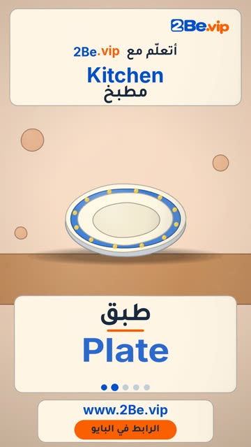

# EP07 — Kitchen

Part of **[Clay Reels](../README.md)**.

[](https://github.com/waseemRIT/2be-vip-content/releases/download/media-clay-reels/EP07_Kitchen.mp4)

▶️ **[Watch / download the video](https://github.com/waseemRIT/2be-vip-content/releases/download/media-clay-reels/EP07_Kitchen.mp4)** (0:29, 5 MB)

## Caption

```text
Kitchen | مطبخ — 5 English words 🎨
Cup = كوب · Plate = طبق · Spoon = ملعقة · Fork = شوكة · Bowl = وعاء

تعلّم الإنجليزي مع 2Be.vip — الرابط في البايو 🔗
Learn English with 2Be.vip — link in bio

Music: "Look Busy" Kevin MacLeod (incompetech.com) — CC BY 4.0

#2Be #2BeVIP #تعلم_الانجليزي #LearnEnglish #English
```

---

<div dir="rtl">

# الحلقة 07 — Kitchen

جزء من **[ريلز الصلصال](../README.md)**.

[](https://github.com/waseemRIT/2be-vip-content/releases/download/media-clay-reels/EP07_Kitchen.mp4)

▶️ **[شاهد / حمّل الفيديو](https://github.com/waseemRIT/2be-vip-content/releases/download/media-clay-reels/EP07_Kitchen.mp4)** (0:29، 5 ميجابايت)

## الكابشن

```text
Kitchen | مطبخ — 5 English words 🎨
Cup = كوب · Plate = طبق · Spoon = ملعقة · Fork = شوكة · Bowl = وعاء

تعلّم الإنجليزي مع 2Be.vip — الرابط في البايو 🔗
Learn English with 2Be.vip — link in bio

Music: "Look Busy" Kevin MacLeod (incompetech.com) — CC BY 4.0

#2Be #2BeVIP #تعلم_الانجليزي #LearnEnglish #English
```

</div>
