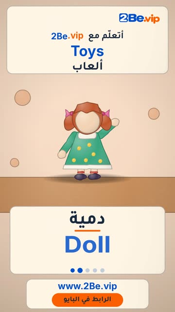

# EP15 — Toys

Part of **[Clay Reels](../README.md)**.

[](https://github.com/waseemRIT/2be-vip-content/releases/download/media-clay-reels/EP15_Toys.mp4)

▶️ **[Watch / download the video](https://github.com/waseemRIT/2be-vip-content/releases/download/media-clay-reels/EP15_Toys.mp4)** (0:29, 6 MB)

## Caption

```text
Toys | ألعاب — 5 English words 🎨
Ball = كرة · Doll = دمية · Teddy bear = دب محشو · Blocks = مكعبات · Balloon = بالون

تعلّم الإنجليزي مع 2Be.vip — الرابط في البايو 🔗
Learn English with 2Be.vip — link in bio

Music: "Hyperfun" Kevin MacLeod (incompetech.com) — CC BY 4.0

#2Be #2BeVIP #تعلم_الانجليزي #LearnEnglish #English
```

---

<div dir="rtl">

# الحلقة 15 — Toys

جزء من **[ريلز الصلصال](../README.md)**.

[](https://github.com/waseemRIT/2be-vip-content/releases/download/media-clay-reels/EP15_Toys.mp4)

▶️ **[شاهد / حمّل الفيديو](https://github.com/waseemRIT/2be-vip-content/releases/download/media-clay-reels/EP15_Toys.mp4)** (0:29، 6 ميجابايت)

## الكابشن

```text
Toys | ألعاب — 5 English words 🎨
Ball = كرة · Doll = دمية · Teddy bear = دب محشو · Blocks = مكعبات · Balloon = بالون

تعلّم الإنجليزي مع 2Be.vip — الرابط في البايو 🔗
Learn English with 2Be.vip — link in bio

Music: "Hyperfun" Kevin MacLeod (incompetech.com) — CC BY 4.0

#2Be #2BeVIP #تعلم_الانجليزي #LearnEnglish #English
```

</div>
