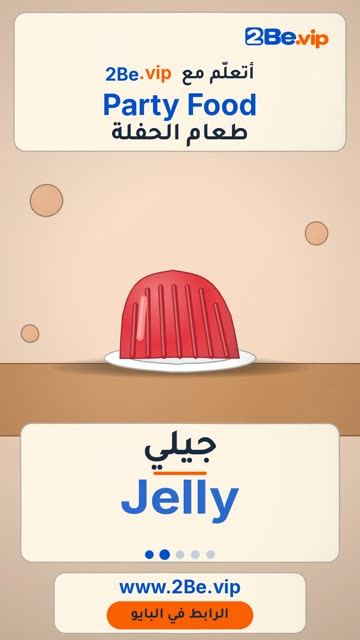

# EP33 — Party Food

Part of **[Clay Reels](../README.md)**.

[](https://github.com/waseemRIT/2be-vip-content/releases/download/media-clay-reels/EP33_Party_Food.mp4)

▶️ **[Watch / download the video](https://github.com/waseemRIT/2be-vip-content/releases/download/media-clay-reels/EP33_Party_Food.mp4)** (0:29, 6 MB)

## Caption

```text
Party Food | طعام الحفلة — 5 English words 🧁
Cupcake = كب كيك · Jelly = جيلي · Lollipop = مصاصة · Marshmallow = مارشملو · Candy floss = غزل البنات

تعلّم الإنجليزي مع 2Be.vip — الرابط في البايو 🔗
Learn English with 2Be.vip — link in bio

Music: "Glee Club Polka" Kevin MacLeod (incompetech.com) — CC BY 4.0

#2Be #2BeVIP #تعلم_الانجليزي #LearnEnglish #English
```

---

<div dir="rtl">

# الحلقة 33 — Party Food

جزء من **[ريلز الصلصال](../README.md)**.

[](https://github.com/waseemRIT/2be-vip-content/releases/download/media-clay-reels/EP33_Party_Food.mp4)

▶️ **[شاهد / حمّل الفيديو](https://github.com/waseemRIT/2be-vip-content/releases/download/media-clay-reels/EP33_Party_Food.mp4)** (0:29، 6 ميجابايت)

## الكابشن

```text
Party Food | طعام الحفلة — 5 English words 🧁
Cupcake = كب كيك · Jelly = جيلي · Lollipop = مصاصة · Marshmallow = مارشملو · Candy floss = غزل البنات

تعلّم الإنجليزي مع 2Be.vip — الرابط في البايو 🔗
Learn English with 2Be.vip — link in bio

Music: "Glee Club Polka" Kevin MacLeod (incompetech.com) — CC BY 4.0

#2Be #2BeVIP #تعلم_الانجليزي #LearnEnglish #English
```

</div>
