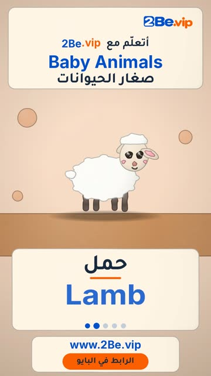

# EP40 — Baby Animals

Part of **[Clay Reels](../README.md)**.

[](https://github.com/waseemRIT/2be-vip-content/releases/download/media-clay-reels/EP40_Baby_Animals.mp4)

▶️ **[Watch / download the video](https://github.com/waseemRIT/2be-vip-content/releases/download/media-clay-reels/EP40_Baby_Animals.mp4)** (0:29, 6 MB)

## Caption

```text
Baby Animals | صغار الحيوانات — 5 English words 🐣
Chick = كتكوت · Lamb = حمل · Calf = عجل · Puppy = جرو · Kitten = قطة صغيرة

تعلّم الإنجليزي مع 2Be.vip — الرابط في البايو 🔗
Learn English with 2Be.vip — link in bio

Music: "Doobly Doo" Kevin MacLeod (incompetech.com) — CC BY 4.0

#2Be #2BeVIP #تعلم_الانجليزي #LearnEnglish #English
```

---

<div dir="rtl">

# الحلقة 40 — Baby Animals

جزء من **[ريلز الصلصال](../README.md)**.

[](https://github.com/waseemRIT/2be-vip-content/releases/download/media-clay-reels/EP40_Baby_Animals.mp4)

▶️ **[شاهد / حمّل الفيديو](https://github.com/waseemRIT/2be-vip-content/releases/download/media-clay-reels/EP40_Baby_Animals.mp4)** (0:29، 6 ميجابايت)

## الكابشن

```text
Baby Animals | صغار الحيوانات — 5 English words 🐣
Chick = كتكوت · Lamb = حمل · Calf = عجل · Puppy = جرو · Kitten = قطة صغيرة

تعلّم الإنجليزي مع 2Be.vip — الرابط في البايو 🔗
Learn English with 2Be.vip — link in bio

Music: "Doobly Doo" Kevin MacLeod (incompetech.com) — CC BY 4.0

#2Be #2BeVIP #تعلم_الانجليزي #LearnEnglish #English
```

</div>
