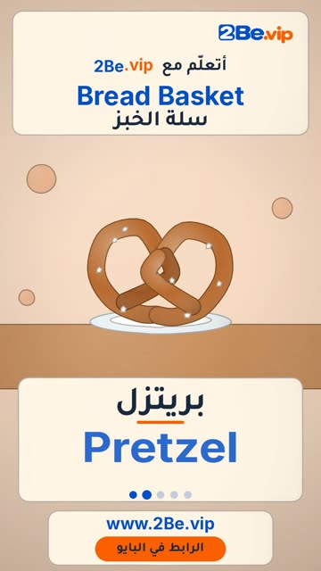

# EP46 — Bread Basket

Part of **[Clay Reels](../README.md)**.

[](https://github.com/waseemRIT/2be-vip-content/releases/download/media-clay-reels/EP46_Bread_Basket.mp4)

▶️ **[Watch / download the video](https://github.com/waseemRIT/2be-vip-content/releases/download/media-clay-reels/EP46_Bread_Basket.mp4)** (0:29, 6 MB)

## Caption

```text
Bread Basket | سلة الخبز — 5 English words 🥖
Baguette = خبز فرنسي · Pretzel = بريتزل · Breadstick = عود الخبز · Scone = كعكة سكون · Tart = تارت

تعلّم الإنجليزي مع 2Be.vip — الرابط في البايو 🔗
Learn English with 2Be.vip — link in bio

Music: "The Entertainer" Kevin MacLeod (incompetech.com) — CC BY 4.0

#2Be #2BeVIP #تعلم_الانجليزي #LearnEnglish #English
```

---

<div dir="rtl">

# الحلقة 46 — Bread Basket

جزء من **[ريلز الصلصال](../README.md)**.

[](https://github.com/waseemRIT/2be-vip-content/releases/download/media-clay-reels/EP46_Bread_Basket.mp4)

▶️ **[شاهد / حمّل الفيديو](https://github.com/waseemRIT/2be-vip-content/releases/download/media-clay-reels/EP46_Bread_Basket.mp4)** (0:29، 6 ميجابايت)

## الكابشن

```text
Bread Basket | سلة الخبز — 5 English words 🥖
Baguette = خبز فرنسي · Pretzel = بريتزل · Breadstick = عود الخبز · Scone = كعكة سكون · Tart = تارت

تعلّم الإنجليزي مع 2Be.vip — الرابط في البايو 🔗
Learn English with 2Be.vip — link in bio

Music: "The Entertainer" Kevin MacLeod (incompetech.com) — CC BY 4.0

#2Be #2BeVIP #تعلم_الانجليزي #LearnEnglish #English
```

</div>
