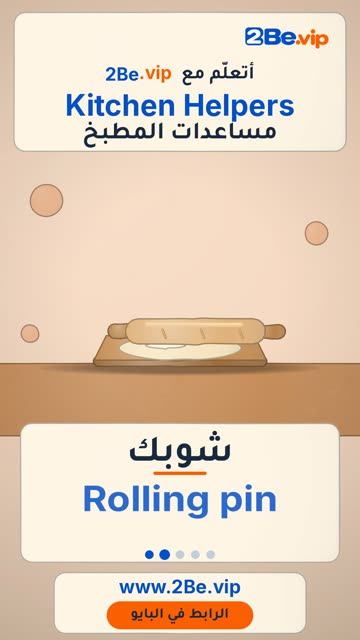

# EP48 — Kitchen Helpers

Part of **[Clay Reels](../README.md)**.

[](https://github.com/waseemRIT/2be-vip-content/releases/download/media-clay-reels/EP48_Kitchen_Helpers.mp4)

▶️ **[Watch / download the video](https://github.com/waseemRIT/2be-vip-content/releases/download/media-clay-reels/EP48_Kitchen_Helpers.mp4)** (0:29, 6 MB)

## Caption

```text
Kitchen Helpers | مساعدات المطبخ — 5 English words 🥄
Spatula = ملعقة مسطحة · Rolling pin = شوبك · Grater = مبشرة · Sieve = مصفاة · Tongs = ملقط

تعلّم الإنجليزي مع 2Be.vip — الرابط في البايو 🔗
Learn English with 2Be.vip — link in bio

Music: "Funk Game Loop" Kevin MacLeod (incompetech.com) — CC BY 4.0

#2Be #2BeVIP #تعلم_الانجليزي #LearnEnglish #English
```

---

<div dir="rtl">

# الحلقة 48 — Kitchen Helpers

جزء من **[ريلز الصلصال](../README.md)**.

[](https://github.com/waseemRIT/2be-vip-content/releases/download/media-clay-reels/EP48_Kitchen_Helpers.mp4)

▶️ **[شاهد / حمّل الفيديو](https://github.com/waseemRIT/2be-vip-content/releases/download/media-clay-reels/EP48_Kitchen_Helpers.mp4)** (0:29، 6 ميجابايت)

## الكابشن

```text
Kitchen Helpers | مساعدات المطبخ — 5 English words 🥄
Spatula = ملعقة مسطحة · Rolling pin = شوبك · Grater = مبشرة · Sieve = مصفاة · Tongs = ملقط

تعلّم الإنجليزي مع 2Be.vip — الرابط في البايو 🔗
Learn English with 2Be.vip — link in bio

Music: "Funk Game Loop" Kevin MacLeod (incompetech.com) — CC BY 4.0

#2Be #2BeVIP #تعلم_الانجليزي #LearnEnglish #English
```

</div>
