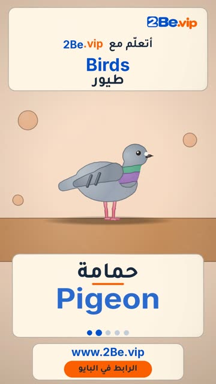

# EP66 — Birds

Part of **[Clay Reels](../README.md)**.

[](https://github.com/waseemRIT/2be-vip-content/releases/download/media-clay-reels/EP66_Birds.mp4)

▶️ **[Watch / download the video](https://github.com/waseemRIT/2be-vip-content/releases/download/media-clay-reels/EP66_Birds.mp4)** (0:29, 6 MB)

## Caption

```text
Birds | طيور — 5 English words 🦜
Parrot = ببغاء · Pigeon = حمامة · Flamingo = فلامنغو · Peacock = طاووس · Sparrow = عصفور

تعلّم الإنجليزي مع 2Be.vip — الرابط في البايو 🔗
Learn English with 2Be.vip — link in bio

Music: "Nothing Broken" Kevin MacLeod (incompetech.com) — CC BY 4.0

#2Be #2BeVIP #تعلم_الانجليزي #LearnEnglish #English
```

---

<div dir="rtl">

# الحلقة 66 — Birds

جزء من **[ريلز الصلصال](../README.md)**.

[](https://github.com/waseemRIT/2be-vip-content/releases/download/media-clay-reels/EP66_Birds.mp4)

▶️ **[شاهد / حمّل الفيديو](https://github.com/waseemRIT/2be-vip-content/releases/download/media-clay-reels/EP66_Birds.mp4)** (0:29، 6 ميجابايت)

## الكابشن

```text
Birds | طيور — 5 English words 🦜
Parrot = ببغاء · Pigeon = حمامة · Flamingo = فلامنغو · Peacock = طاووس · Sparrow = عصفور

تعلّم الإنجليزي مع 2Be.vip — الرابط في البايو 🔗
Learn English with 2Be.vip — link in bio

Music: "Nothing Broken" Kevin MacLeod (incompetech.com) — CC BY 4.0

#2Be #2BeVIP #تعلم_الانجليزي #LearnEnglish #English
```

</div>
