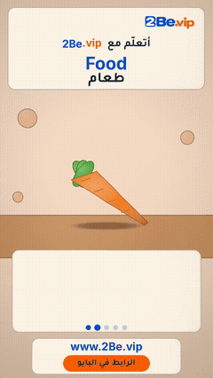

# Clay Reels

Clay objects squash into shape while the English word appears with its pronunciation in Arabic letters.

**19 posts.** Click a thumbnail to open the post (video, caption and download link).

<table>
<tr><td align="center" valign="top"><a href="EP01%20Food/"> EP01 · Food</a></td><td align="center" valign="top"><a href="EP02%20Fruit/"> EP02 · Fruit</a></td><td align="center" valign="top"><a href="EP03%20Vegetables/"> EP03 · Vegetables</a></td><td align="center" valign="top"><a href="EP04%20Breakfast/"> EP04 · Breakfast</a></td></tr>
<tr><td align="center" valign="top"><a href="EP05%20Drinks/"> EP05 · Drinks</a></td><td align="center" valign="top"><a href="EP06%20Sweets/"> EP06 · Sweets</a></td><td align="center" valign="top"><a href="EP07%20Kitchen/"> EP07 · Kitchen</a></td><td align="center" valign="top"><a href="EP08%20Snacks/"> EP08 · Snacks</a></td></tr>
<tr><td align="center" valign="top"><a href="EP09%20Pets/"> EP09 · Pets</a></td><td align="center" valign="top"><a href="EP10%20Farm%20Animals/"> EP10 · Farm Animals</a></td><td align="center" valign="top"><a href="EP11%20Dairy/"> EP11 · Dairy</a></td><td align="center" valign="top"><a href="EP12%20Lunch/"> EP12 · Lunch</a></td></tr>
<tr><td align="center" valign="top"><a href="EP13%20Arab%20Breakfast/"> EP13 · Arab Breakfast</a></td><td align="center" valign="top"><a href="EP14%20At%20the%20Table/"> EP14 · At the Table</a></td><td align="center" valign="top"><a href="EP15%20Toys/"> EP15 · Toys</a></td><td align="center" valign="top"><a href="EP16%20Baking/"> EP16 · Baking</a></td></tr>
<tr><td align="center" valign="top"><a href="EP17%20Big%20Fruits/"> EP17 · Big Fruits</a></td><td align="center" valign="top"><a href="EP18%20Green%20Vegetables/"> EP18 · Green Vegetables</a></td><td align="center" valign="top"><a href="EP19%20Shapes/"> EP19 · Shapes</a></td></tr>
</table>

---

# ريلز الصلصال

أشياء من الصلصال تتشكّل أمامك، مع الكلمة الإنجليزية ونطقها بالحروف العربية.

**19 منشور.** اضغط على أي صورة لفتح المنشور (الفيديو والكابشن ورابط التحميل).

<table>
<tr><td align="center" valign="top"><a href="EP01%20Food/"> الحلقة 01 · Food</a></td><td align="center" valign="top"><a href="EP02%20Fruit/"> الحلقة 02 · Fruit</a></td><td align="center" valign="top"><a href="EP03%20Vegetables/"> الحلقة 03 · Vegetables</a></td><td align="center" valign="top"><a href="EP04%20Breakfast/"> الحلقة 04 · Breakfast</a></td></tr>
<tr><td align="center" valign="top"><a href="EP05%20Drinks/"> الحلقة 05 · Drinks</a></td><td align="center" valign="top"><a href="EP06%20Sweets/"> الحلقة 06 · Sweets</a></td><td align="center" valign="top"><a href="EP07%20Kitchen/"> الحلقة 07 · Kitchen</a></td><td align="center" valign="top"><a href="EP08%20Snacks/"> الحلقة 08 · Snacks</a></td></tr>
<tr><td align="center" valign="top"><a href="EP09%20Pets/"> الحلقة 09 · Pets</a></td><td align="center" valign="top"><a href="EP10%20Farm%20Animals/"> الحلقة 10 · Farm Animals</a></td><td align="center" valign="top"><a href="EP11%20Dairy/"> الحلقة 11 · Dairy</a></td><td align="center" valign="top"><a href="EP12%20Lunch/"> الحلقة 12 · Lunch</a></td></tr>
<tr><td align="center" valign="top"><a href="EP13%20Arab%20Breakfast/"> الحلقة 13 · Arab Breakfast</a></td><td align="center" valign="top"><a href="EP14%20At%20the%20Table/"> الحلقة 14 · At the Table</a></td><td align="center" valign="top"><a href="EP15%20Toys/"> الحلقة 15 · Toys</a></td><td align="center" valign="top"><a href="EP16%20Baking/"> الحلقة 16 · Baking</a></td></tr>
<tr><td align="center" valign="top"><a href="EP17%20Big%20Fruits/"> الحلقة 17 · Big Fruits</a></td><td align="center" valign="top"><a href="EP18%20Green%20Vegetables/"> الحلقة 18 · Green Vegetables</a></td><td align="center" valign="top"><a href="EP19%20Shapes/"> الحلقة 19 · Shapes</a></td></tr>
</table>

