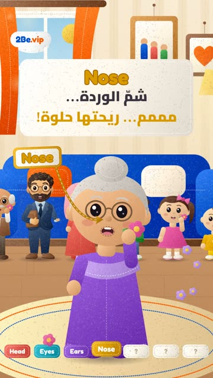

# EP08 — Body parts

Part of **[2Be Felt Songs](../README.md)**.

[](https://github.com/waseemRIT/2be-vip-content/releases/download/media-felt-songs/EP08_Body_parts.mp4)

▶️ **[Watch / download the video](https://github.com/waseemRIT/2be-vip-content/releases/download/media-felt-songs/EP08_Body_parts.mp4)** (1:31, 50 MB)

## Caption

```text
Body parts | 2Be.vip

أغنية للأطفال تعلّم كلمات إنجليزي بالعامية المصرية 🎵
Kids' songs in a handmade felt style that teach English words with an Egyptian Arabic song.

تعلّم الإنجليزي مع 2Be.vip — الرابط في البايو 🔗
Learn English with 2Be.vip — link in bio

#2Be #2BeVIP #تعلم_الانجليزي #LearnEnglish #English
```

---

<div dir="rtl">

# الحلقة 08 — Body parts

جزء من **[أغاني 2Be باللباد](../README.md)**.

[](https://github.com/waseemRIT/2be-vip-content/releases/download/media-felt-songs/EP08_Body_parts.mp4)

▶️ **[شاهد / حمّل الفيديو](https://github.com/waseemRIT/2be-vip-content/releases/download/media-felt-songs/EP08_Body_parts.mp4)** (1:31، 50 ميجابايت)

## الكابشن

```text
Body parts | 2Be.vip

أغنية للأطفال تعلّم كلمات إنجليزي بالعامية المصرية 🎵
Kids' songs in a handmade felt style that teach English words with an Egyptian Arabic song.

تعلّم الإنجليزي مع 2Be.vip — الرابط في البايو 🔗
Learn English with 2Be.vip — link in bio

#2Be #2BeVIP #تعلم_الانجليزي #LearnEnglish #English
```

</div>
