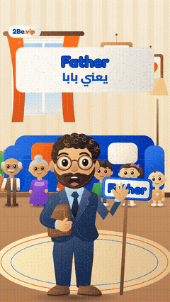

# 2Be Felt Songs

Kids' songs in a handmade felt style that teach English words with an Egyptian Arabic song.

**11 posts.** Click a thumbnail to open the post (video, caption and download link).

<table>
<tr><td align="center" valign="top"><a href="EP01%20Family/"> EP01 · Family</a></td><td align="center" valign="top"><a href="EP02%20Colours/"> EP02 · Colours</a></td><td align="center" valign="top"><a href="EP03%20Numbers/"> EP03 · Numbers</a></td><td align="center" valign="top"><a href="EP04%20Days%20of%20the%20week/"> EP04 · Days of the week</a></td></tr>
<tr><td align="center" valign="top"><a href="EP05%20Months%201/"> EP05 · Months 1</a></td><td align="center" valign="top"><a href="EP06%20Months%202/"> EP06 · Months 2</a></td><td align="center" valign="top"><a href="EP07%20Feelings/"> EP07 · Feelings</a></td><td align="center" valign="top"><a href="EP08%20Body%20parts/"> EP08 · Body parts</a></td></tr>
<tr><td align="center" valign="top"><a href="EP09%20My%20face/"> EP09 · My face</a></td><td align="center" valign="top"><a href="EP10%20Farm%20animals/"> EP10 · Farm animals</a></td><td align="center" valign="top"><a href="EP12%20Sea%20animals/"> EP12 · Sea animals</a></td></tr>
</table>

---

# أغاني 2Be باللباد

أغاني أطفال بأسلوب اللباد المصنوع يدوياً، تعلّم كلمات إنجليزية من خلال أغنية بالعامية المصرية.

**11 منشور.** اضغط على أي صورة لفتح المنشور (الفيديو والكابشن ورابط التحميل).

<table>
<tr><td align="center" valign="top"><a href="EP01%20Family/"> الحلقة 01 · Family</a></td><td align="center" valign="top"><a href="EP02%20Colours/"> الحلقة 02 · Colours</a></td><td align="center" valign="top"><a href="EP03%20Numbers/"> الحلقة 03 · Numbers</a></td><td align="center" valign="top"><a href="EP04%20Days%20of%20the%20week/"> الحلقة 04 · Days of the week</a></td></tr>
<tr><td align="center" valign="top"><a href="EP05%20Months%201/"> الحلقة 05 · Months 1</a></td><td align="center" valign="top"><a href="EP06%20Months%202/"> الحلقة 06 · Months 2</a></td><td align="center" valign="top"><a href="EP07%20Feelings/"> الحلقة 07 · Feelings</a></td><td align="center" valign="top"><a href="EP08%20Body%20parts/"> الحلقة 08 · Body parts</a></td></tr>
<tr><td align="center" valign="top"><a href="EP09%20My%20face/"> الحلقة 09 · My face</a></td><td align="center" valign="top"><a href="EP10%20Farm%20animals/"> الحلقة 10 · Farm animals</a></td><td align="center" valign="top"><a href="EP12%20Sea%20animals/"> الحلقة 12 · Sea animals</a></td></tr>
</table>

