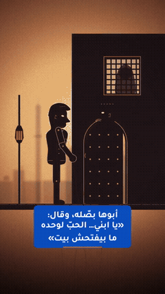

# Hamada — Shadow Puppet Stories

Short emotional shadow-puppet stories about Hamada, told by an Egyptian narrator, each ending on hope through English.

**1 posts.** Click a thumbnail to open the post (video, caption and download link).

<table>
<tr><td align="center" valign="top"><a href="EP01%20The%20Ring/"> EP01 · The Ring</a></td></tr>
</table>

---

# حكايات حمادة — مسرح خيال الظل

حكايات قصيرة مؤثرة بخيال الظل عن حمادة، يرويها راوٍ مصري، وتنتهي كل حكاية بأمل عن طريق الإنجليزي.

**1 منشور.** اضغط على أي صورة لفتح المنشور (الفيديو والكابشن ورابط التحميل).

<table>
<tr><td align="center" valign="top"><a href="EP01%20The%20Ring/"> الحلقة 01 · The Ring</a></td></tr>
</table>

