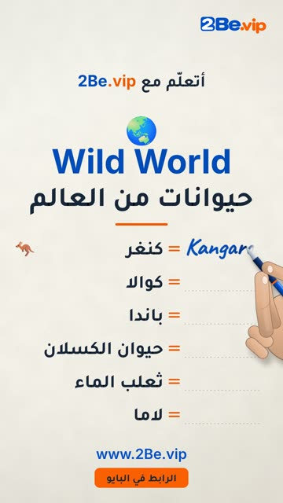

# EP159 — World Animals

Part of **[Handwriting Reels](../README.md)**.

[](https://github.com/waseemRIT/2be-vip-content/releases/download/media-handwriting/EP159_World_Animals.mp4)

▶️ **[Watch / download the video](https://github.com/waseemRIT/2be-vip-content/releases/download/media-handwriting/EP159_World_Animals.mp4)** (0:19, 4 MB)

## Caption

```text
World Animals | 2Be.vip

كلمات إنجليزي مكتوبة بخط اليد مع معناها بالعربي ✍️
A pen writes English words and their Arabic meaning on paper — one themed word list per reel.

تعلّم الإنجليزي مع 2Be.vip — الرابط في البايو 🔗
Learn English with 2Be.vip — link in bio

#2Be #2BeVIP #تعلم_الانجليزي #LearnEnglish #English
```

---

<div dir="rtl">

# الحلقة 159 — World Animals

جزء من **[ريلز الكتابة بخط اليد](../README.md)**.

[](https://github.com/waseemRIT/2be-vip-content/releases/download/media-handwriting/EP159_World_Animals.mp4)

▶️ **[شاهد / حمّل الفيديو](https://github.com/waseemRIT/2be-vip-content/releases/download/media-handwriting/EP159_World_Animals.mp4)** (0:19، 4 ميجابايت)

## الكابشن

```text
World Animals | 2Be.vip

كلمات إنجليزي مكتوبة بخط اليد مع معناها بالعربي ✍️
A pen writes English words and their Arabic meaning on paper — one themed word list per reel.

تعلّم الإنجليزي مع 2Be.vip — الرابط في البايو 🔗
Learn English with 2Be.vip — link in bio

#2Be #2BeVIP #تعلم_الانجليزي #LearnEnglish #English
```

</div>
