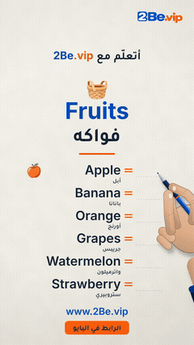

# Handwriting Reels

A pen writes English words and their Arabic meaning on paper — one themed word list per reel.

**21 posts.** Click a thumbnail to open the post (video, caption and download link).

<table>
<tr><td align="center" valign="top"><a href="EP01%20Fruits/"> EP01 · Fruits</a></td><td align="center" valign="top"><a href="EP02%20Colors/"> EP02 · Colors</a></td><td align="center" valign="top"><a href="EP03%20Transport/"> EP03 · Transport</a></td><td align="center" valign="top"><a href="EP04%20Vegetables/"> EP04 · Vegetables</a></td></tr>
<tr><td align="center" valign="top"><a href="EP05%20Family/"> EP05 · Family</a></td><td align="center" valign="top"><a href="EP06%20My%20Body/"> EP06 · My Body</a></td><td align="center" valign="top"><a href="EP07%20Clothes/"> EP07 · Clothes</a></td><td align="center" valign="top"><a href="EP08%20Animals/"> EP08 · Animals</a></td></tr>
<tr><td align="center" valign="top"><a href="EP09%20Farm/"> EP09 · Farm</a></td><td align="center" valign="top"><a href="EP10%20Wild%20Animals/"> EP10 · Wild Animals</a></td><td align="center" valign="top"><a href="EP11%20Birds/"> EP11 · Birds</a></td><td align="center" valign="top"><a href="EP12%20Sea%20Life/"> EP12 · Sea Life</a></td></tr>
<tr><td align="center" valign="top"><a href="EP13%20Insects/"> EP13 · Insects</a></td><td align="center" valign="top"><a href="EP14%20Weather/"> EP14 · Weather</a></td><td align="center" valign="top"><a href="EP15%20Seasons/"> EP15 · Seasons</a></td><td align="center" valign="top"><a href="EP16%20Days/"> EP16 · Days</a></td></tr>
<tr><td align="center" valign="top"><a href="EP17%20Months/"> EP17 · Months</a></td><td align="center" valign="top"><a href="EP18%20Numbers%201-6/"> EP18 · Numbers 1-6</a></td><td align="center" valign="top"><a href="EP19%20Numbers%207-12/"> EP19 · Numbers 7-12</a></td><td align="center" valign="top"><a href="EP20%20Time/"> EP20 · Time</a></td></tr>
<tr><td align="center" valign="top"><a href="EP21%20Kitchen/"> EP21 · Kitchen</a></td></tr>
</table>

---

# ريلز الكتابة بخط اليد

قلم يكتب كلمات إنجليزية ومعناها بالعربي على الورق — قائمة كلمات بموضوع واحد في كل ريل.

**21 منشور.** اضغط على أي صورة لفتح المنشور (الفيديو والكابشن ورابط التحميل).

<table>
<tr><td align="center" valign="top"><a href="EP01%20Fruits/"> الحلقة 01 · Fruits</a></td><td align="center" valign="top"><a href="EP02%20Colors/"> الحلقة 02 · Colors</a></td><td align="center" valign="top"><a href="EP03%20Transport/"> الحلقة 03 · Transport</a></td><td align="center" valign="top"><a href="EP04%20Vegetables/"> الحلقة 04 · Vegetables</a></td></tr>
<tr><td align="center" valign="top"><a href="EP05%20Family/"> الحلقة 05 · Family</a></td><td align="center" valign="top"><a href="EP06%20My%20Body/"> الحلقة 06 · My Body</a></td><td align="center" valign="top"><a href="EP07%20Clothes/"> الحلقة 07 · Clothes</a></td><td align="center" valign="top"><a href="EP08%20Animals/"> الحلقة 08 · Animals</a></td></tr>
<tr><td align="center" valign="top"><a href="EP09%20Farm/"> الحلقة 09 · Farm</a></td><td align="center" valign="top"><a href="EP10%20Wild%20Animals/"> الحلقة 10 · Wild Animals</a></td><td align="center" valign="top"><a href="EP11%20Birds/"> الحلقة 11 · Birds</a></td><td align="center" valign="top"><a href="EP12%20Sea%20Life/"> الحلقة 12 · Sea Life</a></td></tr>
<tr><td align="center" valign="top"><a href="EP13%20Insects/"> الحلقة 13 · Insects</a></td><td align="center" valign="top"><a href="EP14%20Weather/"> الحلقة 14 · Weather</a></td><td align="center" valign="top"><a href="EP15%20Seasons/"> الحلقة 15 · Seasons</a></td><td align="center" valign="top"><a href="EP16%20Days/"> الحلقة 16 · Days</a></td></tr>
<tr><td align="center" valign="top"><a href="EP17%20Months/"> الحلقة 17 · Months</a></td><td align="center" valign="top"><a href="EP18%20Numbers%201-6/"> الحلقة 18 · Numbers 1-6</a></td><td align="center" valign="top"><a href="EP19%20Numbers%207-12/"> الحلقة 19 · Numbers 7-12</a></td><td align="center" valign="top"><a href="EP20%20Time/"> الحلقة 20 · Time</a></td></tr>
<tr><td align="center" valign="top"><a href="EP21%20Kitchen/"> الحلقة 21 · Kitchen</a></td></tr>
</table>

