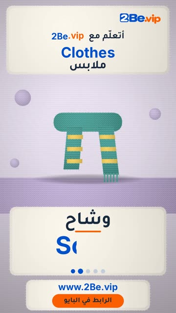

# EP01 — Clothes

Part of **[Knitted Reels](../README.md)**.

[](https://github.com/waseemRIT/2be-vip-content/releases/download/media-knitted-reels/EP01_Clothes.mp4)

▶️ **[Watch / download the video](https://github.com/waseemRIT/2be-vip-content/releases/download/media-knitted-reels/EP01_Clothes.mp4)** (0:29, 7 MB)

## Caption

```text
Clothes | ملابس — 5 English words 🎨
Hat = قبعة · Scarf = وشاح · Socks = جوارب · Sweater = كنزة · Gloves = قفازات

تعلّم الإنجليزي مع 2Be.vip — الرابط في البايو 🔗
Learn English with 2Be.vip — link in bio

Music: "Fluffing a Duck" Kevin MacLeod (incompetech.com) — CC BY 4.0

#2Be #2BeVIP #تعلم_الانجليزي #LearnEnglish #English
```

---

<div dir="rtl">

# الحلقة 01 — Clothes

جزء من **[ريلز الصوف المحبوك](../README.md)**.

[](https://github.com/waseemRIT/2be-vip-content/releases/download/media-knitted-reels/EP01_Clothes.mp4)

▶️ **[شاهد / حمّل الفيديو](https://github.com/waseemRIT/2be-vip-content/releases/download/media-knitted-reels/EP01_Clothes.mp4)** (0:29، 7 ميجابايت)

## الكابشن

```text
Clothes | ملابس — 5 English words 🎨
Hat = قبعة · Scarf = وشاح · Socks = جوارب · Sweater = كنزة · Gloves = قفازات

تعلّم الإنجليزي مع 2Be.vip — الرابط في البايو 🔗
Learn English with 2Be.vip — link in bio

Music: "Fluffing a Duck" Kevin MacLeod (incompetech.com) — CC BY 4.0

#2Be #2BeVIP #تعلم_الانجليزي #LearnEnglish #English
```

</div>
