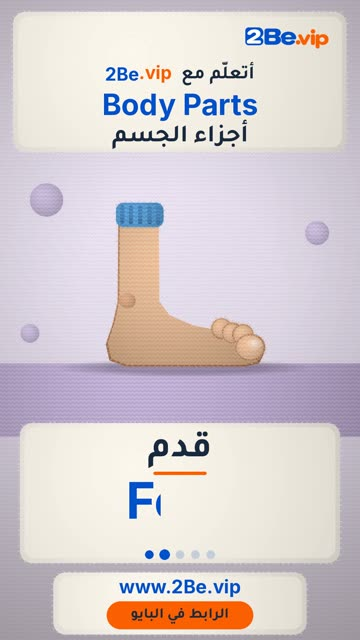

# EP13 — Body Parts

Part of **[Knitted Reels](../README.md)**.

[](https://github.com/waseemRIT/2be-vip-content/releases/download/media-knitted-reels/EP13_Body_Parts.mp4)

▶️ **[Watch / download the video](https://github.com/waseemRIT/2be-vip-content/releases/download/media-knitted-reels/EP13_Body_Parts.mp4)** (0:29, 8 MB)

## Caption

```text
Body Parts | أجزاء الجسم — 5 English words 🎨
Hand = يد · Foot = قدم · Nose = أنف · Ear = أذن · Eye = عين

تعلّم الإنجليزي مع 2Be.vip — الرابط في البايو 🔗
Learn English with 2Be.vip — link in bio

Music: "Music to Delight" Kevin MacLeod (incompetech.com) — CC BY 4.0

#2Be #2BeVIP #تعلم_الانجليزي #LearnEnglish #English
```

---

<div dir="rtl">

# الحلقة 13 — Body Parts

جزء من **[ريلز الصوف المحبوك](../README.md)**.

[](https://github.com/waseemRIT/2be-vip-content/releases/download/media-knitted-reels/EP13_Body_Parts.mp4)

▶️ **[شاهد / حمّل الفيديو](https://github.com/waseemRIT/2be-vip-content/releases/download/media-knitted-reels/EP13_Body_Parts.mp4)** (0:29، 8 ميجابايت)

## الكابشن

```text
Body Parts | أجزاء الجسم — 5 English words 🎨
Hand = يد · Foot = قدم · Nose = أنف · Ear = أذن · Eye = عين

تعلّم الإنجليزي مع 2Be.vip — الرابط في البايو 🔗
Learn English with 2Be.vip — link in bio

Music: "Music to Delight" Kevin MacLeod (incompetech.com) — CC BY 4.0

#2Be #2BeVIP #تعلم_الانجليزي #LearnEnglish #English
```

</div>
