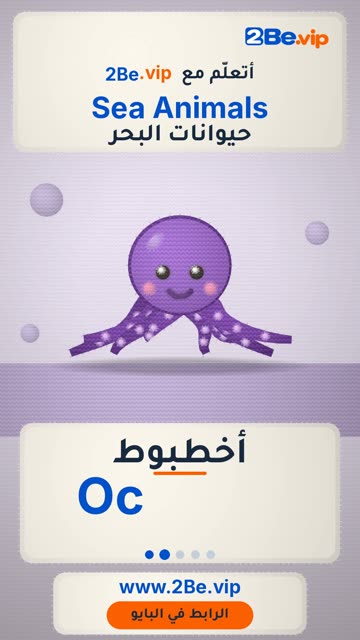

# EP26 — Sea Animals

Part of **[Knitted Reels](../README.md)**.

[](https://github.com/waseemRIT/2be-vip-content/releases/download/media-knitted-reels/EP26_Sea_Animals.mp4)

▶️ **[Watch / download the video](https://github.com/waseemRIT/2be-vip-content/releases/download/media-knitted-reels/EP26_Sea_Animals.mp4)** (0:29, 9 MB)

## Caption

```text
Sea Animals | حيوانات البحر — 5 English words 🐙
Fish = سمكة · Octopus = أخطبوط · Whale = حوت · Crab = سلطعون · Starfish = نجم البحر

تعلّم الإنجليزي مع 2Be.vip — الرابط في البايو 🔗
Learn English with 2Be.vip — link in bio

Music: "Beachfront Celebration" Kevin MacLeod (incompetech.com) — CC BY 4.0

#2Be #2BeVIP #تعلم_الانجليزي #LearnEnglish #English
```

---

<div dir="rtl">

# الحلقة 26 — Sea Animals

جزء من **[ريلز الصوف المحبوك](../README.md)**.

[](https://github.com/waseemRIT/2be-vip-content/releases/download/media-knitted-reels/EP26_Sea_Animals.mp4)

▶️ **[شاهد / حمّل الفيديو](https://github.com/waseemRIT/2be-vip-content/releases/download/media-knitted-reels/EP26_Sea_Animals.mp4)** (0:29، 9 ميجابايت)

## الكابشن

```text
Sea Animals | حيوانات البحر — 5 English words 🐙
Fish = سمكة · Octopus = أخطبوط · Whale = حوت · Crab = سلطعون · Starfish = نجم البحر

تعلّم الإنجليزي مع 2Be.vip — الرابط في البايو 🔗
Learn English with 2Be.vip — link in bio

Music: "Beachfront Celebration" Kevin MacLeod (incompetech.com) — CC BY 4.0

#2Be #2BeVIP #تعلم_الانجليزي #LearnEnglish #English
```

</div>
