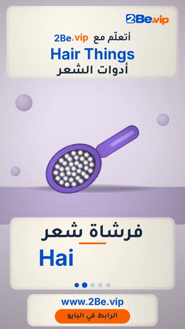

# EP42 — Hair Things

Part of **[Knitted Reels](../README.md)**.

[](https://github.com/waseemRIT/2be-vip-content/releases/download/media-knitted-reels/EP42_Hair_Things.mp4)

▶️ **[Watch / download the video](https://github.com/waseemRIT/2be-vip-content/releases/download/media-knitted-reels/EP42_Hair_Things.mp4)** (0:29, 9 MB)

## Caption

```text
Hair Things | أدوات الشعر — 5 English words 🎀
Comb = مشط · Hairbrush = فرشاة شعر · Hairband = طوق شعر · Hair clip = مشبك شعر · Scrunchie = ربطة شعر

تعلّم الإنجليزي مع 2Be.vip — الرابط في البايو 🔗
Learn English with 2Be.vip — link in bio

Music: "Funky Chunk" Kevin MacLeod (incompetech.com) — CC BY 4.0

#2Be #2BeVIP #تعلم_الانجليزي #LearnEnglish #English
```

---

<div dir="rtl">

# الحلقة 42 — Hair Things

جزء من **[ريلز الصوف المحبوك](../README.md)**.

[](https://github.com/waseemRIT/2be-vip-content/releases/download/media-knitted-reels/EP42_Hair_Things.mp4)

▶️ **[شاهد / حمّل الفيديو](https://github.com/waseemRIT/2be-vip-content/releases/download/media-knitted-reels/EP42_Hair_Things.mp4)** (0:29، 9 ميجابايت)

## الكابشن

```text
Hair Things | أدوات الشعر — 5 English words 🎀
Comb = مشط · Hairbrush = فرشاة شعر · Hairband = طوق شعر · Hair clip = مشبك شعر · Scrunchie = ربطة شعر

تعلّم الإنجليزي مع 2Be.vip — الرابط في البايو 🔗
Learn English with 2Be.vip — link in bio

Music: "Funky Chunk" Kevin MacLeod (incompetech.com) — CC BY 4.0

#2Be #2BeVIP #تعلم_الانجليزي #LearnEnglish #English
```

</div>
