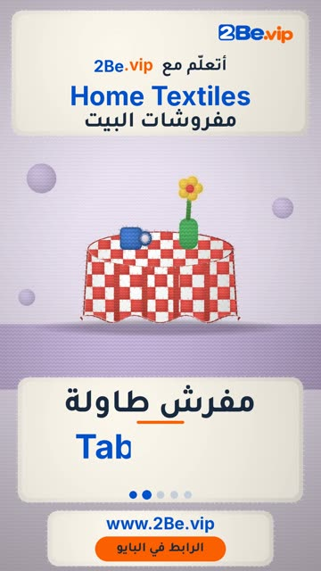

# EP55 — Home Textiles

Part of **[Knitted Reels](../README.md)**.

[](https://github.com/waseemRIT/2be-vip-content/releases/download/media-knitted-reels/EP55_Home_Textiles.mp4)

▶️ **[Watch / download the video](https://github.com/waseemRIT/2be-vip-content/releases/download/media-knitted-reels/EP55_Home_Textiles.mp4)** (0:29, 10 MB)

## Caption

```text
Home Textiles | مفروشات البيت — 5 English words 🧺
Quilt = لحاف · Tablecloth = مفرش طاولة · Doormat = ممسحة أرجل · Bedsheet = ملاءة سرير · Tea cosy = غطاء الإبريق

تعلّم الإنجليزي مع 2Be.vip — الرابط في البايو 🔗
Learn English with 2Be.vip — link in bio

Music: "Peppy Pepe" Kevin MacLeod (incompetech.com) — CC BY 4.0

#2Be #2BeVIP #تعلم_الانجليزي #LearnEnglish #English
```

---

<div dir="rtl">

# الحلقة 55 — Home Textiles

جزء من **[ريلز الصوف المحبوك](../README.md)**.

[](https://github.com/waseemRIT/2be-vip-content/releases/download/media-knitted-reels/EP55_Home_Textiles.mp4)

▶️ **[شاهد / حمّل الفيديو](https://github.com/waseemRIT/2be-vip-content/releases/download/media-knitted-reels/EP55_Home_Textiles.mp4)** (0:29، 10 ميجابايت)

## الكابشن

```text
Home Textiles | مفروشات البيت — 5 English words 🧺
Quilt = لحاف · Tablecloth = مفرش طاولة · Doormat = ممسحة أرجل · Bedsheet = ملاءة سرير · Tea cosy = غطاء الإبريق

تعلّم الإنجليزي مع 2Be.vip — الرابط في البايو 🔗
Learn English with 2Be.vip — link in bio

Music: "Peppy Pepe" Kevin MacLeod (incompetech.com) — CC BY 4.0

#2Be #2BeVIP #تعلم_الانجليزي #LearnEnglish #English
```

</div>
