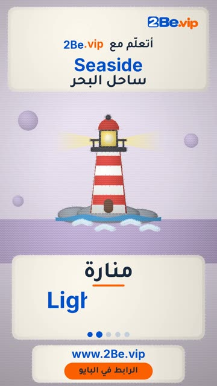

# EP57 — Seaside

Part of **[Knitted Reels](../README.md)**.

[](https://github.com/waseemRIT/2be-vip-content/releases/download/media-knitted-reels/EP57_Seaside.mp4)

▶️ **[Watch / download the video](https://github.com/waseemRIT/2be-vip-content/releases/download/media-knitted-reels/EP57_Seaside.mp4)** (0:29, 9 MB)

## Caption

```text
Seaside | ساحل البحر — 5 English words 🌊
Wave = موجة · Lighthouse = منارة · Anchor = مرساة · Seagull = نورس · Island = جزيرة

تعلّم الإنجليزي مع 2Be.vip — الرابط في البايو 🔗
Learn English with 2Be.vip — link in bio

Music: "Surf Shimmy" Kevin MacLeod (incompetech.com) — CC BY 4.0

#2Be #2BeVIP #تعلم_الانجليزي #LearnEnglish #English
```

---

<div dir="rtl">

# الحلقة 57 — Seaside

جزء من **[ريلز الصوف المحبوك](../README.md)**.

[](https://github.com/waseemRIT/2be-vip-content/releases/download/media-knitted-reels/EP57_Seaside.mp4)

▶️ **[شاهد / حمّل الفيديو](https://github.com/waseemRIT/2be-vip-content/releases/download/media-knitted-reels/EP57_Seaside.mp4)** (0:29، 9 ميجابايت)

## الكابشن

```text
Seaside | ساحل البحر — 5 English words 🌊
Wave = موجة · Lighthouse = منارة · Anchor = مرساة · Seagull = نورس · Island = جزيرة

تعلّم الإنجليزي مع 2Be.vip — الرابط في البايو 🔗
Learn English with 2Be.vip — link in bio

Music: "Surf Shimmy" Kevin MacLeod (incompetech.com) — CC BY 4.0

#2Be #2BeVIP #تعلم_الانجليزي #LearnEnglish #English
```

</div>
