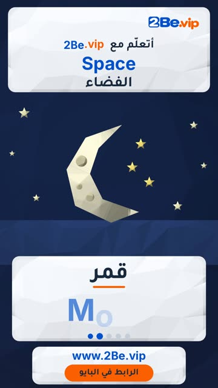

# EP01 — Space

Part of **[Low-poly 3D Reels](../README.md)**.

[](https://github.com/waseemRIT/2be-vip-content/releases/download/media-lowpoly-reels/EP01_Space.mp4)

▶️ **[Watch / download the video](https://github.com/waseemRIT/2be-vip-content/releases/download/media-lowpoly-reels/EP01_Space.mp4)** (0:29, 3 MB)

## Caption

```text
Space | الفضاء — 5 English words 🎨
Sun = شمس · Moon = قمر · Star = نجمة · Rocket = صاروخ · Planet = كوكب

تعلّم الإنجليزي مع 2Be.vip — الرابط في البايو 🔗
Learn English with 2Be.vip — link in bio

Music: "Carefree" Kevin MacLeod (incompetech.com) — CC BY 4.0

#2Be #2BeVIP #تعلم_الانجليزي #LearnEnglish #English
```

---

<div dir="rtl">

# الحلقة 01 — Space

جزء من **[ريلز المجسّمات ثلاثية الأبعاد](../README.md)**.

[](https://github.com/waseemRIT/2be-vip-content/releases/download/media-lowpoly-reels/EP01_Space.mp4)

▶️ **[شاهد / حمّل الفيديو](https://github.com/waseemRIT/2be-vip-content/releases/download/media-lowpoly-reels/EP01_Space.mp4)** (0:29، 3 ميجابايت)

## الكابشن

```text
Space | الفضاء — 5 English words 🎨
Sun = شمس · Moon = قمر · Star = نجمة · Rocket = صاروخ · Planet = كوكب

تعلّم الإنجليزي مع 2Be.vip — الرابط في البايو 🔗
Learn English with 2Be.vip — link in bio

Music: "Carefree" Kevin MacLeod (incompetech.com) — CC BY 4.0

#2Be #2BeVIP #تعلم_الانجليزي #LearnEnglish #English
```

</div>
