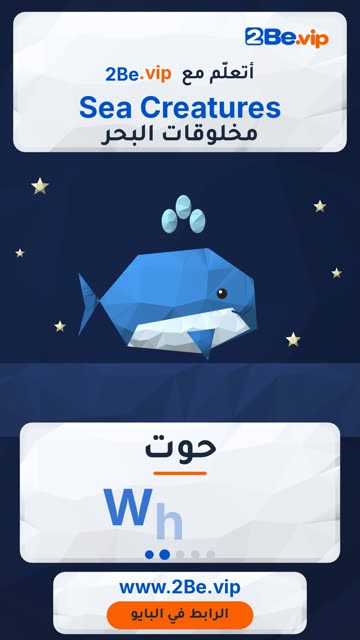

# EP07 — Sea Creatures

Part of **[Low-poly 3D Reels](../README.md)**.

[](https://github.com/waseemRIT/2be-vip-content/releases/download/media-lowpoly-reels/EP07_Sea_Creatures.mp4)

▶️ **[Watch / download the video](https://github.com/waseemRIT/2be-vip-content/releases/download/media-lowpoly-reels/EP07_Sea_Creatures.mp4)** (0:29, 4 MB)

## Caption

```text
Sea Creatures | مخلوقات البحر — 5 English words 🎨
Fish = سمكة · Whale = حوت · Dolphin = دلفين · Octopus = أخطبوط · Crab = سلطعون

تعلّم الإنجليزي مع 2Be.vip — الرابط في البايو 🔗
Learn English with 2Be.vip — link in bio

Music: "Island Meet and Greet" Kevin MacLeod (incompetech.com) — CC BY 4.0

#2Be #2BeVIP #تعلم_الانجليزي #LearnEnglish #English
```

---

<div dir="rtl">

# الحلقة 07 — Sea Creatures

جزء من **[ريلز المجسّمات ثلاثية الأبعاد](../README.md)**.

[](https://github.com/waseemRIT/2be-vip-content/releases/download/media-lowpoly-reels/EP07_Sea_Creatures.mp4)

▶️ **[شاهد / حمّل الفيديو](https://github.com/waseemRIT/2be-vip-content/releases/download/media-lowpoly-reels/EP07_Sea_Creatures.mp4)** (0:29، 4 ميجابايت)

## الكابشن

```text
Sea Creatures | مخلوقات البحر — 5 English words 🎨
Fish = سمكة · Whale = حوت · Dolphin = دلفين · Octopus = أخطبوط · Crab = سلطعون

تعلّم الإنجليزي مع 2Be.vip — الرابط في البايو 🔗
Learn English with 2Be.vip — link in bio

Music: "Island Meet and Greet" Kevin MacLeod (incompetech.com) — CC BY 4.0

#2Be #2BeVIP #تعلم_الانجليزي #LearnEnglish #English
```

</div>
