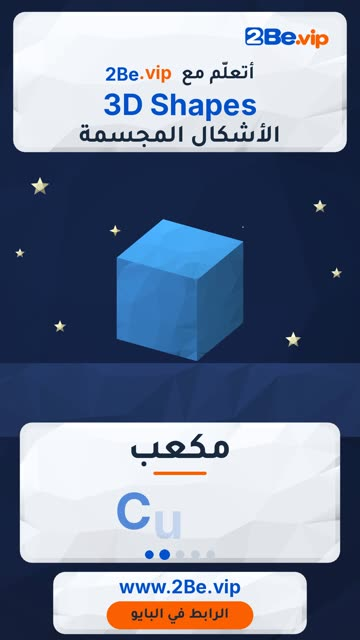

# EP08 — 3D Shapes

Part of **[Low-poly 3D Reels](../README.md)**.

[](https://github.com/waseemRIT/2be-vip-content/releases/download/media-lowpoly-reels/EP08_3D_Shapes.mp4)

▶️ **[Watch / download the video](https://github.com/waseemRIT/2be-vip-content/releases/download/media-lowpoly-reels/EP08_3D_Shapes.mp4)** (0:29, 4 MB)

## Caption

```text
3D Shapes | الأشكال المجسمة — 5 English words 🎨
Sphere = كرة · Cube = مكعب · Pyramid = هرم · Cylinder = أسطوانة · Cone = مخروط

تعلّم الإنجليزي مع 2Be.vip — الرابط في البايو 🔗
Learn English with 2Be.vip — link in bio

Music: "Glitter Blast" Kevin MacLeod (incompetech.com) — CC BY 4.0

#2Be #2BeVIP #تعلم_الانجليزي #LearnEnglish #English
```

---

<div dir="rtl">

# الحلقة 08 — 3D Shapes

جزء من **[ريلز المجسّمات ثلاثية الأبعاد](../README.md)**.

[](https://github.com/waseemRIT/2be-vip-content/releases/download/media-lowpoly-reels/EP08_3D_Shapes.mp4)

▶️ **[شاهد / حمّل الفيديو](https://github.com/waseemRIT/2be-vip-content/releases/download/media-lowpoly-reels/EP08_3D_Shapes.mp4)** (0:29، 4 ميجابايت)

## الكابشن

```text
3D Shapes | الأشكال المجسمة — 5 English words 🎨
Sphere = كرة · Cube = مكعب · Pyramid = هرم · Cylinder = أسطوانة · Cone = مخروط

تعلّم الإنجليزي مع 2Be.vip — الرابط في البايو 🔗
Learn English with 2Be.vip — link in bio

Music: "Glitter Blast" Kevin MacLeod (incompetech.com) — CC BY 4.0

#2Be #2BeVIP #تعلم_الانجليزي #LearnEnglish #English
```

</div>
