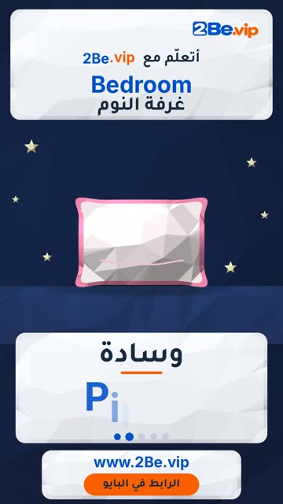

# EP14 — Bedroom

Part of **[Low-poly 3D Reels](../README.md)**.

[](https://github.com/waseemRIT/2be-vip-content/releases/download/media-lowpoly-reels/EP14_Bedroom.mp4)

▶️ **[Watch / download the video](https://github.com/waseemRIT/2be-vip-content/releases/download/media-lowpoly-reels/EP14_Bedroom.mp4)** (0:29, 4 MB)

## Caption

```text
Bedroom | غرفة النوم — 5 English words 🎨
Bed = سرير · Pillow = وسادة · Blanket = بطانية · Wardrobe = خزانة ملابس · Mirror = مرآة

تعلّم الإنجليزي مع 2Be.vip — الرابط في البايو 🔗
Learn English with 2Be.vip — link in bio

Music: "Monkeys Spinning Monkeys" Kevin MacLeod (incompetech.com) — CC BY 4.0

#2Be #2BeVIP #تعلم_الانجليزي #LearnEnglish #English
```

---

<div dir="rtl">

# الحلقة 14 — Bedroom

جزء من **[ريلز المجسّمات ثلاثية الأبعاد](../README.md)**.

[](https://github.com/waseemRIT/2be-vip-content/releases/download/media-lowpoly-reels/EP14_Bedroom.mp4)

▶️ **[شاهد / حمّل الفيديو](https://github.com/waseemRIT/2be-vip-content/releases/download/media-lowpoly-reels/EP14_Bedroom.mp4)** (0:29، 4 ميجابايت)

## الكابشن

```text
Bedroom | غرفة النوم — 5 English words 🎨
Bed = سرير · Pillow = وسادة · Blanket = بطانية · Wardrobe = خزانة ملابس · Mirror = مرآة

تعلّم الإنجليزي مع 2Be.vip — الرابط في البايو 🔗
Learn English with 2Be.vip — link in bio

Music: "Monkeys Spinning Monkeys" Kevin MacLeod (incompetech.com) — CC BY 4.0

#2Be #2BeVIP #تعلم_الانجليزي #LearnEnglish #English
```

</div>
