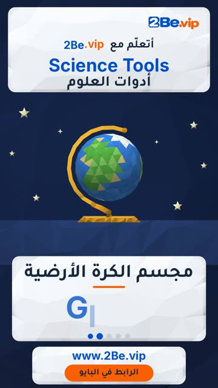

# EP54 — Science Tools

Part of **[Low-poly 3D Reels](../README.md)**.

[](https://github.com/waseemRIT/2be-vip-content/releases/download/media-lowpoly-reels/EP54_Science_Tools.mp4)

▶️ **[Watch / download the video](https://github.com/waseemRIT/2be-vip-content/releases/download/media-lowpoly-reels/EP54_Science_Tools.mp4)** (0:29, 4 MB)

## Caption

```text
Science Tools | أدوات العلوم — 5 English words 🎨
Prism = منشور · Globe = مجسم الكرة الأرضية · Compass = بوصلة · Magnifying Glass = عدسة مكبرة · Battery = بطارية

تعلّم الإنجليزي مع 2Be.vip — الرابط في البايو 🔗
Learn English with 2Be.vip — link in bio

Music: "Awesome Call" Kevin MacLeod (incompetech.com) — CC BY 4.0

#2Be #2BeVIP #تعلم_الانجليزي #LearnEnglish #English
```

---

<div dir="rtl">

# الحلقة 54 — Science Tools

جزء من **[ريلز المجسّمات ثلاثية الأبعاد](../README.md)**.

[](https://github.com/waseemRIT/2be-vip-content/releases/download/media-lowpoly-reels/EP54_Science_Tools.mp4)

▶️ **[شاهد / حمّل الفيديو](https://github.com/waseemRIT/2be-vip-content/releases/download/media-lowpoly-reels/EP54_Science_Tools.mp4)** (0:29، 4 ميجابايت)

## الكابشن

```text
Science Tools | أدوات العلوم — 5 English words 🎨
Prism = منشور · Globe = مجسم الكرة الأرضية · Compass = بوصلة · Magnifying Glass = عدسة مكبرة · Battery = بطارية

تعلّم الإنجليزي مع 2Be.vip — الرابط في البايو 🔗
Learn English with 2Be.vip — link in bio

Music: "Awesome Call" Kevin MacLeod (incompetech.com) — CC BY 4.0

#2Be #2BeVIP #تعلم_الانجليزي #LearnEnglish #English
```

</div>
