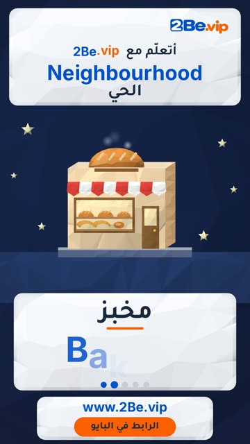

# EP61 — Neighbourhood

Part of **[Low-poly 3D Reels](../README.md)**.

[](https://github.com/waseemRIT/2be-vip-content/releases/download/media-lowpoly-reels/EP61_Neighbourhood.mp4)

▶️ **[Watch / download the video](https://github.com/waseemRIT/2be-vip-content/releases/download/media-lowpoly-reels/EP61_Neighbourhood.mp4)** (0:29, 5 MB)

## Caption

```text
Neighbourhood | الحي — 5 English words 🎨
Mosque = مسجد · Bakery = مخبز · Pharmacy = صيدلية · Post Office = مكتب البريد · Supermarket = سوبرماركت

تعلّم الإنجليزي مع 2Be.vip — الرابط في البايو 🔗
Learn English with 2Be.vip — link in bio

Music: "Thatched Villagers" Kevin MacLeod (incompetech.com) — CC BY 4.0

#2Be #2BeVIP #تعلم_الانجليزي #LearnEnglish #English
```

---

<div dir="rtl">

# الحلقة 61 — Neighbourhood

جزء من **[ريلز المجسّمات ثلاثية الأبعاد](../README.md)**.

[](https://github.com/waseemRIT/2be-vip-content/releases/download/media-lowpoly-reels/EP61_Neighbourhood.mp4)

▶️ **[شاهد / حمّل الفيديو](https://github.com/waseemRIT/2be-vip-content/releases/download/media-lowpoly-reels/EP61_Neighbourhood.mp4)** (0:29، 5 ميجابايت)

## الكابشن

```text
Neighbourhood | الحي — 5 English words 🎨
Mosque = مسجد · Bakery = مخبز · Pharmacy = صيدلية · Post Office = مكتب البريد · Supermarket = سوبرماركت

تعلّم الإنجليزي مع 2Be.vip — الرابط في البايو 🔗
Learn English with 2Be.vip — link in bio

Music: "Thatched Villagers" Kevin MacLeod (incompetech.com) — CC BY 4.0

#2Be #2BeVIP #تعلم_الانجليزي #LearnEnglish #English
```

</div>
