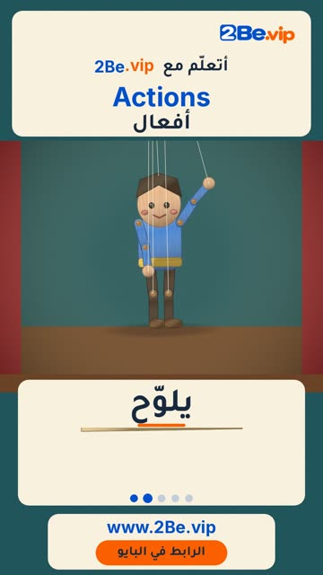

# EP01 — Actions

Part of **[Marionette Reels](../README.md)**.

[](https://github.com/waseemRIT/2be-vip-content/releases/download/media-marionette-reels/EP01_Actions.mp4)

▶️ **[Watch / download the video](https://github.com/waseemRIT/2be-vip-content/releases/download/media-marionette-reels/EP01_Actions.mp4)** (0:29, 6 MB)

## Caption

```text
Actions | أفعال — 5 English words 🎨
Jump = يقفز · Wave = يلوّح · Sit = يجلس · Run = يركض · Clap = يصفّق

تعلّم الإنجليزي مع 2Be.vip — الرابط في البايو 🔗
Learn English with 2Be.vip — link in bio

Music: "Spazzmatica Polka" Kevin MacLeod (incompetech.com) — CC BY 4.0

#2Be #2BeVIP #تعلم_الانجليزي #LearnEnglish #English
```

---

<div dir="rtl">

# الحلقة 01 — Actions

جزء من **[ريلز الدمية المتحركة](../README.md)**.

[](https://github.com/waseemRIT/2be-vip-content/releases/download/media-marionette-reels/EP01_Actions.mp4)

▶️ **[شاهد / حمّل الفيديو](https://github.com/waseemRIT/2be-vip-content/releases/download/media-marionette-reels/EP01_Actions.mp4)** (0:29، 6 ميجابايت)

## الكابشن

```text
Actions | أفعال — 5 English words 🎨
Jump = يقفز · Wave = يلوّح · Sit = يجلس · Run = يركض · Clap = يصفّق

تعلّم الإنجليزي مع 2Be.vip — الرابط في البايو 🔗
Learn English with 2Be.vip — link in bio

Music: "Spazzmatica Polka" Kevin MacLeod (incompetech.com) — CC BY 4.0

#2Be #2BeVIP #تعلم_الانجليزي #LearnEnglish #English
```

</div>
