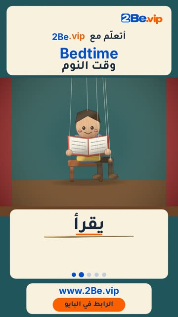

# EP04 — Bedtime

Part of **[Marionette Reels](../README.md)**.

[](https://github.com/waseemRIT/2be-vip-content/releases/download/media-marionette-reels/EP04_Bedtime.mp4)

▶️ **[Watch / download the video](https://github.com/waseemRIT/2be-vip-content/releases/download/media-marionette-reels/EP04_Bedtime.mp4)** (0:29, 6 MB)

## Caption

```text
Bedtime | وقت النوم — 5 English words 🎨
Sleep = ينام · Read = يقرأ · Hug = يعانق · Brush = يفرّش أسنانه · Turn off = يطفئ

تعلّم الإنجليزي مع 2Be.vip — الرابط في البايو 🔗
Learn English with 2Be.vip — link in bio

Music: "Whimsy Groove" Kevin MacLeod (incompetech.com) — CC BY 4.0

#2Be #2BeVIP #تعلم_الانجليزي #LearnEnglish #English
```

---

<div dir="rtl">

# الحلقة 04 — Bedtime

جزء من **[ريلز الدمية المتحركة](../README.md)**.

[](https://github.com/waseemRIT/2be-vip-content/releases/download/media-marionette-reels/EP04_Bedtime.mp4)

▶️ **[شاهد / حمّل الفيديو](https://github.com/waseemRIT/2be-vip-content/releases/download/media-marionette-reels/EP04_Bedtime.mp4)** (0:29، 6 ميجابايت)

## الكابشن

```text
Bedtime | وقت النوم — 5 English words 🎨
Sleep = ينام · Read = يقرأ · Hug = يعانق · Brush = يفرّش أسنانه · Turn off = يطفئ

تعلّم الإنجليزي مع 2Be.vip — الرابط في البايو 🔗
Learn English with 2Be.vip — link in bio

Music: "Whimsy Groove" Kevin MacLeod (incompetech.com) — CC BY 4.0

#2Be #2BeVIP #تعلم_الانجليزي #LearnEnglish #English
```

</div>
