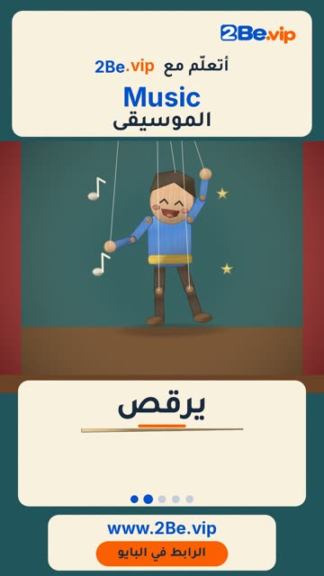

# EP13 — Music

Part of **[Marionette Reels](../README.md)**.

[](https://github.com/waseemRIT/2be-vip-content/releases/download/media-marionette-reels/EP13_Music.mp4)

▶️ **[Watch / download the video](https://github.com/waseemRIT/2be-vip-content/releases/download/media-marionette-reels/EP13_Music.mp4)** (0:29, 7 MB)

## Caption

```text
Music | الموسيقى — 5 English words 🎨
Sing = يغنّي · Dance = يرقص · Drum = يطبّل · Shake = يهزّ · Play = يعزف

تعلّم الإنجليزي مع 2Be.vip — الرابط في البايو 🔗
Learn English with 2Be.vip — link in bio

Music: "Glee Club Polka" Kevin MacLeod (incompetech.com) — CC BY 4.0

#2Be #2BeVIP #تعلم_الانجليزي #LearnEnglish #English
```

---

<div dir="rtl">

# الحلقة 13 — Music

جزء من **[ريلز الدمية المتحركة](../README.md)**.

[](https://github.com/waseemRIT/2be-vip-content/releases/download/media-marionette-reels/EP13_Music.mp4)

▶️ **[شاهد / حمّل الفيديو](https://github.com/waseemRIT/2be-vip-content/releases/download/media-marionette-reels/EP13_Music.mp4)** (0:29، 7 ميجابايت)

## الكابشن

```text
Music | الموسيقى — 5 English words 🎨
Sing = يغنّي · Dance = يرقص · Drum = يطبّل · Shake = يهزّ · Play = يعزف

تعلّم الإنجليزي مع 2Be.vip — الرابط في البايو 🔗
Learn English with 2Be.vip — link in bio

Music: "Glee Club Polka" Kevin MacLeod (incompetech.com) — CC BY 4.0

#2Be #2BeVIP #تعلم_الانجليزي #LearnEnglish #English
```

</div>
