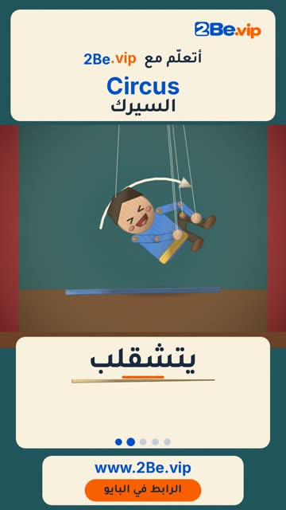

# EP29 — Circus

Part of **[Marionette Reels](../README.md)**.

[](https://github.com/waseemRIT/2be-vip-content/releases/download/media-marionette-reels/EP29_Circus.mp4)

▶️ **[Watch / download the video](https://github.com/waseemRIT/2be-vip-content/releases/download/media-marionette-reels/EP29_Circus.mp4)** (0:29, 7 MB)

## Caption

```text
Circus | السيرك — 5 English words 🎨
Juggle = يتقاذف الكرات · Somersault = يتشقلب · Handstand = يقف على يديه · Balance = يتوازن · Bow = ينحني

تعلّم الإنجليزي مع 2Be.vip — الرابط في البايو 🔗
Learn English with 2Be.vip — link in bio

Music: "Hyperfun" Kevin MacLeod (incompetech.com) — CC BY 4.0

#2Be #2BeVIP #تعلم_الانجليزي #LearnEnglish #English
```

---

<div dir="rtl">

# الحلقة 29 — Circus

جزء من **[ريلز الدمية المتحركة](../README.md)**.

[](https://github.com/waseemRIT/2be-vip-content/releases/download/media-marionette-reels/EP29_Circus.mp4)

▶️ **[شاهد / حمّل الفيديو](https://github.com/waseemRIT/2be-vip-content/releases/download/media-marionette-reels/EP29_Circus.mp4)** (0:29، 7 ميجابايت)

## الكابشن

```text
Circus | السيرك — 5 English words 🎨
Juggle = يتقاذف الكرات · Somersault = يتشقلب · Handstand = يقف على يديه · Balance = يتوازن · Bow = ينحني

تعلّم الإنجليزي مع 2Be.vip — الرابط في البايو 🔗
Learn English with 2Be.vip — link in bio

Music: "Hyperfun" Kevin MacLeod (incompetech.com) — CC BY 4.0

#2Be #2BeVIP #تعلم_الانجليزي #LearnEnglish #English
```

</div>
