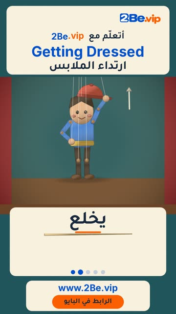

# EP31 — Getting Dressed

Part of **[Marionette Reels](../README.md)**.

[](https://github.com/waseemRIT/2be-vip-content/releases/download/media-marionette-reels/EP31_Getting_Dressed.mp4)

▶️ **[Watch / download the video](https://github.com/waseemRIT/2be-vip-content/releases/download/media-marionette-reels/EP31_Getting_Dressed.mp4)** (0:29, 6 MB)

## Caption

```text
Getting Dressed | ارتداء الملابس — 5 English words 🎨
Put on = يرتدي · Take off = يخلع · Pull up = يرفع جواربه · Zip = يغلق السحّاب · Tie = يربط

تعلّم الإنجليزي مع 2Be.vip — الرابط في البايو 🔗
Learn English with 2Be.vip — link in bio

Music: "Feelin Good" Kevin MacLeod (incompetech.com) — CC BY 4.0

#2Be #2BeVIP #تعلم_الانجليزي #LearnEnglish #English
```

---

<div dir="rtl">

# الحلقة 31 — Getting Dressed

جزء من **[ريلز الدمية المتحركة](../README.md)**.

[](https://github.com/waseemRIT/2be-vip-content/releases/download/media-marionette-reels/EP31_Getting_Dressed.mp4)

▶️ **[شاهد / حمّل الفيديو](https://github.com/waseemRIT/2be-vip-content/releases/download/media-marionette-reels/EP31_Getting_Dressed.mp4)** (0:29، 6 ميجابايت)

## الكابشن

```text
Getting Dressed | ارتداء الملابس — 5 English words 🎨
Put on = يرتدي · Take off = يخلع · Pull up = يرفع جواربه · Zip = يغلق السحّاب · Tie = يربط

تعلّم الإنجليزي مع 2Be.vip — الرابط في البايو 🔗
Learn English with 2Be.vip — link in bio

Music: "Feelin Good" Kevin MacLeod (incompetech.com) — CC BY 4.0

#2Be #2BeVIP #تعلم_الانجليزي #LearnEnglish #English
```

</div>
