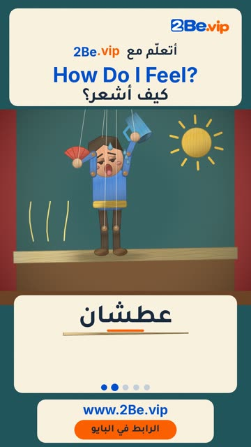

# EP45 — How Do I Feel

Part of **[Marionette Reels](../README.md)**.

[](https://github.com/waseemRIT/2be-vip-content/releases/download/media-marionette-reels/EP45_How_Do_I_Feel.mp4)

▶️ **[Watch / download the video](https://github.com/waseemRIT/2be-vip-content/releases/download/media-marionette-reels/EP45_How_Do_I_Feel.mp4)** (0:29, 7 MB)

## Caption

```text
How Do I Feel? | كيف أشعر؟ — 5 English words 😊
Hungry = جائع · Thirsty = عطشان · Sick = مريض · Sleepy = نعسان · Brave = شجاع

تعلّم الإنجليزي مع 2Be.vip — الرابط في البايو 🔗
Learn English with 2Be.vip — link in bio

Music: "Frogs Legs Rag" Kevin MacLeod (incompetech.com) — CC BY 4.0

#2Be #2BeVIP #تعلم_الانجليزي #LearnEnglish #English
```

---

<div dir="rtl">

# الحلقة 45 — How Do I Feel

جزء من **[ريلز الدمية المتحركة](../README.md)**.

[](https://github.com/waseemRIT/2be-vip-content/releases/download/media-marionette-reels/EP45_How_Do_I_Feel.mp4)

▶️ **[شاهد / حمّل الفيديو](https://github.com/waseemRIT/2be-vip-content/releases/download/media-marionette-reels/EP45_How_Do_I_Feel.mp4)** (0:29، 7 ميجابايت)

## الكابشن

```text
How Do I Feel? | كيف أشعر؟ — 5 English words 😊
Hungry = جائع · Thirsty = عطشان · Sick = مريض · Sleepy = نعسان · Brave = شجاع

تعلّم الإنجليزي مع 2Be.vip — الرابط في البايو 🔗
Learn English with 2Be.vip — link in bio

Music: "Frogs Legs Rag" Kevin MacLeod (incompetech.com) — CC BY 4.0

#2Be #2BeVIP #تعلم_الانجليزي #LearnEnglish #English
```

</div>
