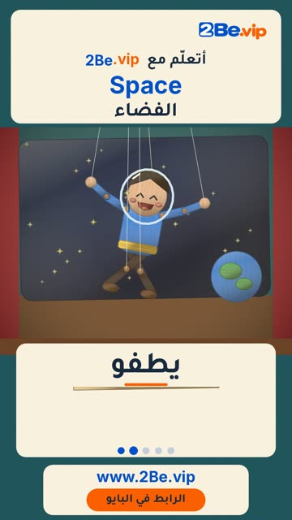

# EP49 — Space

Part of **[Marionette Reels](../README.md)**.

[](https://github.com/waseemRIT/2be-vip-content/releases/download/media-marionette-reels/EP49_Space.mp4)

▶️ **[Watch / download the video](https://github.com/waseemRIT/2be-vip-content/releases/download/media-marionette-reels/EP49_Space.mp4)** (0:29, 8 MB)

## Caption

```text
Space | الفضاء — 5 English words 🚀
Launch = ينطلق · Float = يطفو · Orbit = يدور حول الكوكب · Explore = يستكشف · Land = يهبط

تعلّم الإنجليزي مع 2Be.vip — الرابط في البايو 🔗
Learn English with 2Be.vip — link in bio

Music: "Chipper Doodle v2" Kevin MacLeod (incompetech.com) — CC BY 4.0

#2Be #2BeVIP #تعلم_الانجليزي #LearnEnglish #English
```

---

<div dir="rtl">

# الحلقة 49 — Space

جزء من **[ريلز الدمية المتحركة](../README.md)**.

[](https://github.com/waseemRIT/2be-vip-content/releases/download/media-marionette-reels/EP49_Space.mp4)

▶️ **[شاهد / حمّل الفيديو](https://github.com/waseemRIT/2be-vip-content/releases/download/media-marionette-reels/EP49_Space.mp4)** (0:29، 8 ميجابايت)

## الكابشن

```text
Space | الفضاء — 5 English words 🚀
Launch = ينطلق · Float = يطفو · Orbit = يدور حول الكوكب · Explore = يستكشف · Land = يهبط

تعلّم الإنجليزي مع 2Be.vip — الرابط في البايو 🔗
Learn English with 2Be.vip — link in bio

Music: "Chipper Doodle v2" Kevin MacLeod (incompetech.com) — CC BY 4.0

#2Be #2BeVIP #تعلم_الانجليزي #LearnEnglish #English
```

</div>
