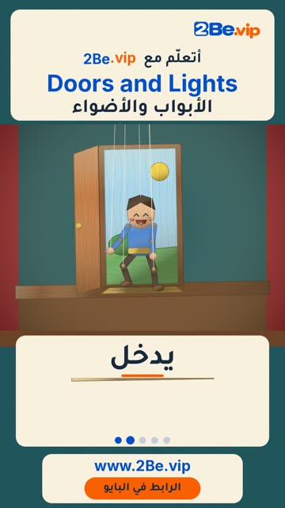

# EP54 — Doors and Lights

Part of **[Marionette Reels](../README.md)**.

[](https://github.com/waseemRIT/2be-vip-content/releases/download/media-marionette-reels/EP54_Doors_and_Lights.mp4)

▶️ **[Watch / download the video](https://github.com/waseemRIT/2be-vip-content/releases/download/media-marionette-reels/EP54_Doors_and_Lights.mp4)** (0:29, 8 MB)

## Caption

```text
Doors and Lights | الأبواب والأضواء — 5 English words 🚪
Ring = يقرع الجرس · Enter = يدخل · Exit = يخرج · Turn on = يشغّل · Knock = يطرق

تعلّم الإنجليزي مع 2Be.vip — الرابط في البايو 🔗
Learn English with 2Be.vip — link in bio

Music: "Still Pickin" Kevin MacLeod (incompetech.com) — CC BY 4.0

#2Be #2BeVIP #تعلم_الانجليزي #LearnEnglish #English
```

---

<div dir="rtl">

# الحلقة 54 — Doors and Lights

جزء من **[ريلز الدمية المتحركة](../README.md)**.

[](https://github.com/waseemRIT/2be-vip-content/releases/download/media-marionette-reels/EP54_Doors_and_Lights.mp4)

▶️ **[شاهد / حمّل الفيديو](https://github.com/waseemRIT/2be-vip-content/releases/download/media-marionette-reels/EP54_Doors_and_Lights.mp4)** (0:29، 8 ميجابايت)

## الكابشن

```text
Doors and Lights | الأبواب والأضواء — 5 English words 🚪
Ring = يقرع الجرس · Enter = يدخل · Exit = يخرج · Turn on = يشغّل · Knock = يطرق

تعلّم الإنجليزي مع 2Be.vip — الرابط في البايو 🔗
Learn English with 2Be.vip — link in bio

Music: "Still Pickin" Kevin MacLeod (incompetech.com) — CC BY 4.0

#2Be #2BeVIP #تعلم_الانجليزي #LearnEnglish #English
```

</div>
