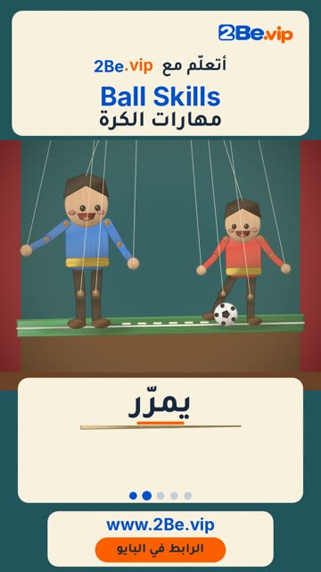

# EP56 — Ball Skills

Part of **[Marionette Reels](../README.md)**.

[](https://github.com/waseemRIT/2be-vip-content/releases/download/media-marionette-reels/EP56_Ball_Skills.mp4)

▶️ **[Watch / download the video](https://github.com/waseemRIT/2be-vip-content/releases/download/media-marionette-reels/EP56_Ball_Skills.mp4)** (0:29, 9 MB)

## Caption

```text
Ball Skills | مهارات الكرة — 5 English words 🏀
Dribble = يراوغ · Pass = يمرّر · Dunk = يسدّد في السلّة · Block = يصدّ · Head = يضرب بالرأس

تعلّم الإنجليزي مع 2Be.vip — الرابط في البايو 🔗
Learn English with 2Be.vip — link in bio

Music: "Hustle" Kevin MacLeod (incompetech.com) — CC BY 4.0

#2Be #2BeVIP #تعلم_الانجليزي #LearnEnglish #English
```

---

<div dir="rtl">

# الحلقة 56 — Ball Skills

جزء من **[ريلز الدمية المتحركة](../README.md)**.

[](https://github.com/waseemRIT/2be-vip-content/releases/download/media-marionette-reels/EP56_Ball_Skills.mp4)

▶️ **[شاهد / حمّل الفيديو](https://github.com/waseemRIT/2be-vip-content/releases/download/media-marionette-reels/EP56_Ball_Skills.mp4)** (0:29، 9 ميجابايت)

## الكابشن

```text
Ball Skills | مهارات الكرة — 5 English words 🏀
Dribble = يراوغ · Pass = يمرّر · Dunk = يسدّد في السلّة · Block = يصدّ · Head = يضرب بالرأس

تعلّم الإنجليزي مع 2Be.vip — الرابط في البايو 🔗
Learn English with 2Be.vip — link in bio

Music: "Hustle" Kevin MacLeod (incompetech.com) — CC BY 4.0

#2Be #2BeVIP #تعلم_الانجليزي #LearnEnglish #English
```

</div>
