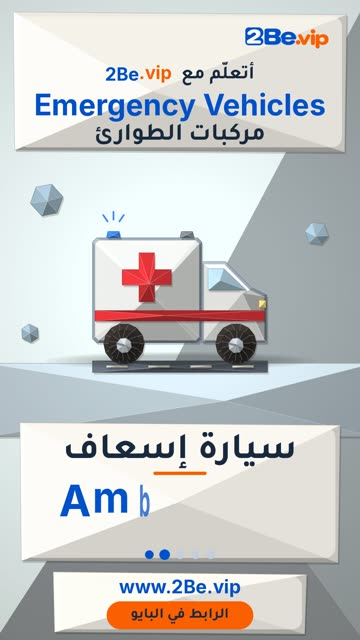

# EP39 — Emergency Vehicles

Part of **[Origami Reels](../README.md)**.

[](https://github.com/waseemRIT/2be-vip-content/releases/download/media-origami-reels/EP39_Emergency_Vehicles.mp4)

▶️ **[Watch / download the video](https://github.com/waseemRIT/2be-vip-content/releases/download/media-origami-reels/EP39_Emergency_Vehicles.mp4)** (0:29, 6 MB)

## Caption

```text
Emergency Vehicles | مركبات الطوارئ — 5 English words 🎨
Fire Truck = شاحنة إطفاء · Ambulance = سيارة إسعاف · Police Car = سيارة شرطة · Tow Truck = شاحنة سحب · Lifeboat = قارب نجاة

تعلّم الإنجليزي مع 2Be.vip — الرابط في البايو 🔗
Learn English with 2Be.vip — link in bio

Music: "Got Funk" Kevin MacLeod (incompetech.com) — CC BY 4.0

#2Be #2BeVIP #تعلم_الانجليزي #LearnEnglish #English
```

---

<div dir="rtl">

# الحلقة 39 — Emergency Vehicles

جزء من **[ريلز الأوريغامي](../README.md)**.

[](https://github.com/waseemRIT/2be-vip-content/releases/download/media-origami-reels/EP39_Emergency_Vehicles.mp4)

▶️ **[شاهد / حمّل الفيديو](https://github.com/waseemRIT/2be-vip-content/releases/download/media-origami-reels/EP39_Emergency_Vehicles.mp4)** (0:29، 6 ميجابايت)

## الكابشن

```text
Emergency Vehicles | مركبات الطوارئ — 5 English words 🎨
Fire Truck = شاحنة إطفاء · Ambulance = سيارة إسعاف · Police Car = سيارة شرطة · Tow Truck = شاحنة سحب · Lifeboat = قارب نجاة

تعلّم الإنجليزي مع 2Be.vip — الرابط في البايو 🔗
Learn English with 2Be.vip — link in bio

Music: "Got Funk" Kevin MacLeod (incompetech.com) — CC BY 4.0

#2Be #2BeVIP #تعلم_الانجليزي #LearnEnglish #English
```

</div>
