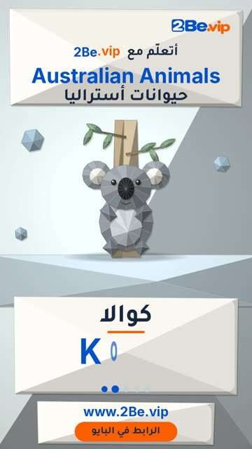

# EP55 — Australian Animals

Part of **[Origami Reels](../README.md)**.

[](https://github.com/waseemRIT/2be-vip-content/releases/download/media-origami-reels/EP55_Australian_Animals.mp4)

▶️ **[Watch / download the video](https://github.com/waseemRIT/2be-vip-content/releases/download/media-origami-reels/EP55_Australian_Animals.mp4)** (0:29, 4 MB)

## Caption

```text
Australian Animals | حيوانات أستراليا — 5 English words 🎨
Kangaroo = كنغر · Koala = كوالا · Platypus = خلد الماء · Emu = إيمو · Wombat = ومبت

تعلّم الإنجليزي مع 2Be.vip — الرابط في البايو 🔗
Learn English with 2Be.vip — link in bio

Music: "Comin Round the Mountain" Kevin MacLeod (incompetech.com) — CC BY 4.0

#2Be #2BeVIP #تعلم_الانجليزي #LearnEnglish #English
```

---

<div dir="rtl">

# الحلقة 55 — Australian Animals

جزء من **[ريلز الأوريغامي](../README.md)**.

[](https://github.com/waseemRIT/2be-vip-content/releases/download/media-origami-reels/EP55_Australian_Animals.mp4)

▶️ **[شاهد / حمّل الفيديو](https://github.com/waseemRIT/2be-vip-content/releases/download/media-origami-reels/EP55_Australian_Animals.mp4)** (0:29، 4 ميجابايت)

## الكابشن

```text
Australian Animals | حيوانات أستراليا — 5 English words 🎨
Kangaroo = كنغر · Koala = كوالا · Platypus = خلد الماء · Emu = إيمو · Wombat = ومبت

تعلّم الإنجليزي مع 2Be.vip — الرابط في البايو 🔗
Learn English with 2Be.vip — link in bio

Music: "Comin Round the Mountain" Kevin MacLeod (incompetech.com) — CC BY 4.0

#2Be #2BeVIP #تعلم_الانجليزي #LearnEnglish #English
```

</div>
